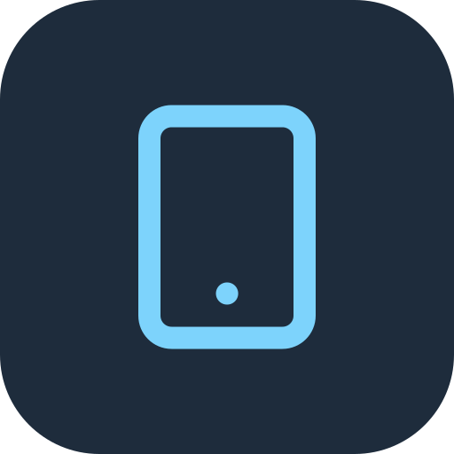

<p align="center">
  
</p>

<h1 align="center">ADBoard</h1>

<p align="center"><b>ANDROID DEVICE CONTROL</b></p>

<p align="center">
  Control Android phones from a web page on your own computer.<br>
  ADBoard runs scrcpy and ADB on the host and shows every connected phone in one browser window.
</p>

<p align="center">
  <a href="https://chr0mx.github.io/ADBoard/">Website</a> ·
  <a href="docs/guide/README.md">User guide</a> ·
  <a href="#quick-start-windows">Quick start</a> ·
  <a href="docs/remote-access.md">Remote access</a> ·
  <a href="docs/architecture.md">Architecture</a>
</p>

<table>
  <tr>
    <td width="50%" valign="top">
      <br>
      <b>Live Control</b><br>
      Live screen mirroring and input. Low-latency H.264 video in the browser, with touch, keyboard and navigation keys.
    </td>
    <td width="50%" valign="top">
      <br>
      <b>Macros &amp; Shell Automation</b><br>
      Macros: record or build finger-touch macros and run them per phone. Shell Automation: app, file, key, shell-command and touch jobs across many phones, built next to a live preview of the phone (see <a href="docs/shell-automation.md">docs/shell-automation.md</a>).
    </td>
  </tr>
  <tr>
    <td width="50%" valign="top">
      <br>
      <b>ADB Terminal</b><br>
      Run ADB shell and device commands, install APKs, and push or pull files.
    </td>
    <td width="50%" valign="top">
      <br>
      <b>Device Fleet</b><br>
      Manage every connected phone, over USB or Wi-Fi, from Windows and Linux hosts in one grid.
    </td>
  </tr>
</table>

## What you need

- **Phones:** Android phones with USB debugging on, plugged in by USB or joined over Wi-Fi. [Getting started](docs/guide/getting-started.md) shows how to turn it on.
- **The computer the phones connect to:** a Windows PC (a ready-made pack is in `dist/windows/`) or a Linux machine.
- **A browser:** current Chrome, Edge or Safari. The picture is decoded in the browser with WebCodecs.
- **ADB and scrcpy:** `make fetch-deps` (or `.\scripts\fetch-deps.ps1` on Windows) downloads and places them.
- **To build or develop:** Rust (stable, see `rust-toolchain.toml`) and Node.js 20.9 or newer (Next.js 16). `ffmpeg` is optional: it only makes the test pattern live.

## Quick start (Windows)

1. Copy `dist/windows/` to the PC.
2. Put ADB and scrcpy in `vendor/`: run `.\scripts\fetch-deps.ps1`, or `make fetch-deps FETCH_TARGET=windows` from WSL.
3. Double-click `run.bat`.
4. Open `http://127.0.0.1:3848/` in a browser on that PC. The same process serves the page and the API.

Then plug in a phone and allow USB debugging when it asks. It appears under **Devices** on the **Control** tab within a few seconds. Details: [`dist/windows/README.md`](dist/windows/README.md) and the [user guide](docs/guide/getting-started.md).

If the listen address is not loopback (`run.bat` listens on all interfaces), set `ADBOARD_TOKEN` so only clients that know the secret can call the API, and allow TCP 3848 in Windows Firewall to use ADBoard from another computer.

## Try it without a phone (developer)

The mock fleet and a synthetic video stream need no phone, ADB or scrcpy:

```bash
# Terminal 1 — controller (mock fleet + synthetic video)
ADBOARD_FORCE_MOCK=1 \
ADBOARD_VIDEO_SOURCE=testpattern \
cargo run -p adboard-agent
# → http://127.0.0.1:3848

# Terminal 2 — Web UI
cp .env.example .env.local   # optional; sets NEXT_PUBLIC_AGENT_URL
npm install
NEXT_PUBLIC_AGENT_URL=http://127.0.0.1:3848 npm run dev -- -p 3847
# → http://127.0.0.1:3847
```

Without `NEXT_PUBLIC_AGENT_URL`, the UI keeps an in-browser mock client and opens no video socket.

Checks:

```bash
npm test                 # UI unit tests
npm run typecheck        # next typegen + tsc
cargo test --workspace   # agent and protocol tests (also: make test-linux)
```

## How it works

scrcpy and ADB carry the video and input. ADBoard handles device discovery, sessions and the web UI. The browser never talks to ADB directly.

| Piece | Path | Port |
|---|---|---|
| Next.js web UI (desk at `/`, phone app at `/m/`) | `src/` | **3847** in development |
| Rust binary (`adboard-agent`) | `crates/adboard-agent` | **3848** controller / **3849** agent |
| Shared protocol types | `crates/adboard-protocol` | none |

The same binary has two roles, set with `--role` or `ADBOARD_ROLE`:

- **controller** (default): serves the UI and API, owns the local phones, collects remote agents and proxies their video
- **agent**: runs ADB, scrcpy or the test pattern locally and registers with a controller over WebSocket

The agent also does the work that must not depend on an open browser: macro runs, schedules, reconnecting phones that drop, and the Quiet Mode Loop. More in [docs/architecture.md](docs/architecture.md).

## The tabs

Each tab has a page in the [user guide](docs/guide/README.md), with screenshots and examples.

| Tab | What it does | Guide |
|---|---|---|
| **Control** | The live phone: Back / Home / Recent, keyboard, touch, record and replay, screenshots, Grid view, Pop out, and a floating Tools panel with a pinnable taskbar on small screens | [control.md](docs/guide/control.md) |
| **Manage** | Actions on the ticked phones: reconnect, restart ADB, reboot, screenshot, record, information, Wi-Fi pairing and per-phone tweaks | [manage.md](docs/guide/manage.md) |
| **Apps** | Saved app buttons, APK install, package scan, and per-app controls (permissions, app ops, battery, network, intents) | [apps.md](docs/guide/apps.md) |
| **Files** | The PC and the phone side by side; upload and drag files between them | [files.md](docs/guide/files.md) |
| **Macros** | Finger-touch macros, one saved file each, run per phone; optional text steps read the screen with offline OCR | [macros.md](docs/guide/macros.md) |
| **Shell Automation** | Jobs of app, file, key, shell-command and touch steps run on many phones, built next to a live preview | [shell-automation.md](docs/guide/shell-automation.md) |
| **Developer** | ADB shell, live logcat, logs and device information | [developer.md](docs/guide/developer.md) |
| **Hosts** | The computers that run ADB and their phones; a second PC or an LXC joins as an agent | [hosts.md](docs/guide/hosts.md) |
| **Events** | History of phones connecting and dropping, macro runs, installs, crashes and failures, with optional Discord notifications | [monitoring.md](docs/monitoring.md) |
| **Storage** | Where your data lives; move it, back it up, export or import the whole library | [storage.md](docs/storage.md) |
| **Settings** | Stream quality and size, Quiet Mode and the Quiet Mode Loop, keyboard and touch, grid and taskbar options, the account, dark / light / system themes and the technical-value font, and installing ADBoard on an iPhone | [settings.md](docs/guide/settings.md) |

Good to know:

- **Macro runs live in ADBoard**, so they keep going when the browser closes. They stop when ADBoard itself is closed.
- **Quiet Mode** turns every online phone's screen off and mutes it. **Quiet Mode Loop** (Settings → Stream) repeats that on and off at an interval you set in minutes or hours. The agent keeps the time, so it carries on with the browser closed and after an agent restart.
- **When a phone is unplugged**, the agent resets a display size it had changed, tries to turn the screen on, and retries `adb reconnect` on a growing delay. A small alert tells you once when a phone disconnects and once when it is back.
- **Keyboard shortcuts** use Alt+Shift (⌥⇧ on a Mac) so they still work while typing goes to the phone; the list is in the [Control guide](docs/guide/control.md#keyboard-shortcuts).

## Your data

Macros, Shell Automation scripts, settings, logs, backups and the phone model list live in one folder outside the app, so Git pulls, updates and reinstalls never touch them:

| System | Data folder |
|---|---|
| Windows | `%LOCALAPPDATA%\ADBoard` |
| macOS | `~/Library/Application Support/ADBoard` |
| Linux / LXC | `$XDG_DATA_HOME/ADBoard` or `~/.local/share/ADBoard` |

On the Windows pack the data is kept in the `ADBoard` folder in the repository root. Set `ADBOARD_DATA_DIR` for a portable install. Data from older versions (`adboard-data`, `data\phonecontrol-files`) is moved in on first start, and the originals are kept in `backups\legacy-<date>`. Details: [docs/storage.md](docs/storage.md).

## More than one computer, and remote access

- A second PC or a Proxmox LXC can run the same binary as an **agent** and register with the controller: [docs/deployment.md](docs/deployment.md) (also covers fetching ADB and scrcpy, the bind address, and building the Windows pack).
- To publish ADBoard on a hostname behind Nginx Proxy Manager and Cloudflare, **create an account first**. Without one, ADBoard refuses to hand out its API token to requests that came through a proxy. Steps: [docs/remote-access.md](docs/remote-access.md).

## Documentation

| Page | Covers |
|---|---|
| [User guide](docs/guide/README.md) | Every tab, with screenshots, and troubleshooting |
| [docs/architecture.md](docs/architecture.md) | Processes, critical paths, auth |
| [docs/deployment.md](docs/deployment.md) | Agents, LXC, `make fetch-deps`, the Windows pack |
| [docs/reference.md](docs/reference.md) | Environment flags, API routes, the video protocol and scrcpy launch |
| [docs/remote-access.md](docs/remote-access.md) | Nginx Proxy Manager and Cloudflare |
| [docs/storage.md](docs/storage.md) | The data folder |
| [docs/macros.md](docs/macros.md) · [docs/shell-automation.md](docs/shell-automation.md) | Macros and Shell Automation |
| [docs/phone-controls.md](docs/phone-controls.md) · [docs/virtual-display.md](docs/virtual-display.md) | App controls and extra Android displays |
| [docs/monitoring.md](docs/monitoring.md) | Events and Discord |
| [docs/performance.md](docs/performance.md) · [docs/typography.md](docs/typography.md) · [docs/themes.md](docs/themes.md) | Performance work, the type system and the colour themes |

## Limits

- Back, Home and Recent are sent as `adb shell input keyevent`. Touch and typing use the scrcpy control socket.
- Video is H.264 over a WebSocket decoded with WebCodecs. There is no WebRTC.
- The Windows pack is a zip-ready folder: no MSI, signed installer or auto-update.
- USB passthrough to a Proxmox LXC is not documented yet.
- A phone that is physically unplugged can't receive commands, so the screen-wake and size reset on unplug only work while ADB can still reach it.

## Built with

- Frontend: Next.js · TypeScript · Tailwind · shadcn/ui · WebCodecs
- Backend: Rust · Axum · Tokio (one codebase for `ADBoard.exe` on Windows and `adboard-agent` on Linux)

## Layout

```text
crates/
  adboard-protocol/   shared wire types, mesh frames, coordinate and adb helpers
  adboard-agent/      the controller/agent binary: API, sessions, video, ADB, mesh
src/                  Next.js UI
public/               service workers and manifest for the desk and the phone app
docs/                 architecture, reference, deployment, storage, macros ...
  guide/              the user guide: a page per tab, with screenshots
dist/windows/         the Windows host pack (ADBoard.exe, run.bat, vendor/, ui/)
scripts/              build-windows, package-windows, fetch-deps, verify-pack, bench and audit
site/                 the GitHub Pages site; site/assets holds the logo and icons used here
.github/workflows/    CI: tests, Windows pack, Pages
Makefile              fetch-deps, build-windows, package-windows, test-linux
```

## License

MIT, as declared in `Cargo.toml`.
