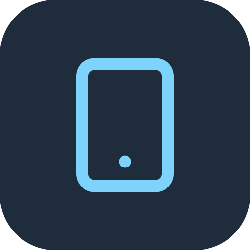

<p align="center">
  
</p>

<h1 align="center">ADBoard</h1>

<p align="center"><b>ANDROID DEVICE CONTROL</b></p>

<p align="center">
  Control Android phones from a web page on your own computer.<br>
  ADBoard runs scrcpy and ADB on the host and shows every connected phone in one browser window.
</p>

<p align="center">
  <a href="https://chr0mx.github.io/ADBoard/">Website</a> ·
  <a href="docs/guide/README.md">User guide</a> ·
  <a href="#run-on-windows-operator">Quick start</a> ·
  <a href="#remote-access-nginx-proxy-manager--cloudflare">Remote access</a> ·
  <a href="docs/architecture.md">Architecture</a>
</p>

<table>
  <tr>
    <td width="50%" valign="top">
      <br>
      <b>Live Control</b><br>
      Live screen mirroring and input. Low-latency H.264 video in the browser, with touch, keyboard and navigation keys.
    </td>
    <td width="50%" valign="top">
      <br>
      <b>Macros &amp; Shell Automation</b><br>
      Macros: record or build finger-touch macros and run them per phone. Shell Automation: app, file, key, shell-command and touch jobs across many phones, built next to a live preview of the phone (see [docs/shell-automation.md](docs/shell-automation.md)).
    </td>
  </tr>
  <tr>
    <td width="50%" valign="top">
      <br>
      <b>ADB Terminal</b><br>
      Run ADB shell and device commands, install APKs, and push or pull files.
    </td>
    <td width="50%" valign="top">
      <br>
      <b>Device Fleet</b><br>
      Manage every connected phone, over USB or Wi-Fi, from Windows and Linux hosts in one grid.
    </td>
  </tr>
</table>

New here? The [user guide](docs/guide/README.md) has a page for each tab, with screenshots and examples, from connecting your first phone to Macros and Shell Automation.

## How it works

scrcpy and ADB carry the video and input. ADBoard handles device discovery, sessions, and the web UI. The browser never talks to ADB directly.

## Components

| Piece | Path | Port |
|---|---|---|
| Next.js Web UI | `src/` | **3847** |
| Rust binary (`adboard-agent`) | `crates/adboard-agent` | **3848** controller / **3849** agent |
| Shared protocol types | `crates/adboard-protocol` | none |

Same binary, two roles via `--role` / `ADBOARD_ROLE`:

- **controller** (default): serves the UI API, owns the local devices, collects the remote agents, and proxies their video WebSocket
- **agent**: runs ADB, scrcpy or the test pattern locally, and registers with a controller over WebSocket

## Video (H264 over WebSocket)

`WS /ws/devices/{serial}/video`:

| Frame | Meaning |
|---|---|
| **Text** JSON | `VideoStatusFrame`: `stream`, `backend`, and optional `codec`, `codecString`, `width`, `height` and `framing` |
| **Binary** | One **Annex-B** H264 access unit (start-code NALs; keyframes carry SPS/PPS + IDR) |

The UI decodes the frames with **WebCodecs** `VideoDecoder` and draws them on a canvas. Switching the active device only changes the video subscription, so agent sessions stay up.

### Synthetic test pattern (no phones / no scrcpy)

Default when scrcpy is missing (`ADBOARD_VIDEO_SOURCE=auto`):

```bash
ADBOARD_FORCE_MOCK=1 \
ADBOARD_VIDEO_SOURCE=testpattern \
cargo run -p adboard-agent
```

- Prefers live **ffmpeg** `testsrc` → raw H264 on stdout when `ffmpeg` is on `PATH` (or `FFMPEG_PATH`)
- Falls back to embedded fixture `crates/adboard-agent/fixtures/testpattern.h264` (360×640 loop)
- The session reports `backend` = `testpattern` and `stream` = `streaming`. It is a real video stream, not a placeholder image.

Opening the phone screen (or any client on the video WS) auto-starts the pump; closing the WS does **not** stop the session.

### Real scrcpy (raw H264 → WebSocket)

When **ADB** and **scrcpy-server** are available and `ADBOARD_VIDEO_SOURCE=auto|scrcpy`, session start:

1. `adb push` the server jar to the device  
2. `adb forward tcp:PORT localabstract:scrcpy`  
3. Runs the **standalone server** (not the GUI client) with:

```bash
CLASSPATH=/data/local/tmp/adboard-scrcpy-server.jar \
  app_process / com.genymobile.scrcpy.Server <version> \
  tunnel_forward=true audio=false control=true cleanup=false \
  raw_stream=true send_dummy_byte=true video_codec=h264 max_size=1280
```

4. TCP-connects the video socket and the control socket, then reads the one-byte handshake on the video socket (`adb forward` accepts before the device is listening, and scrcpy writes that byte only after both sockets are accepted). The bytes after that are **Annex-B access units**, published on the video hub (`backend: scrcpy`). Finger down, move, and up on the page are written to the control socket as scrcpy touch messages, in the decoded video's pixel size.

`raw_stream=true` is the current scrcpy-supported way to get a bare H264 socket (the client no longer supports `--record-format=h264`). Override version with `SCRCPY_SERVER_VERSION` if the jar filename does not include `vX.Y.Z`.

**USB host verify:**

```bash
# on a machine with adb + a phone + scrcpy release extracted
export ADB_PATH=$(which adb)
export SCRCPY_PATH=/path/to/scrcpy
export SCRCPY_SERVER_PATH=/path/to/scrcpy-server   # or scrcpy-server-v4.1
export ADBOARD_VIDEO_SOURCE=auto
cargo run -p adboard-agent
# UI → open online device → status shows backend: scrcpy / streaming + canvas frames
```

Without phones in this VM, CI uses the Annex-B reader + fixture path (`ADBOARD_SCRCPY_FIXTURE=1` forces `backend: scrcpy` with the embedded H264 loop).

## Run on Windows (operator)

Copy `dist/windows/` to the USB host, drop ADB + scrcpy into `vendor/`, then double-click `run.bat`. The same process serves the control page:

```text
http://127.0.0.1:3848/
```

Details: [`dist/windows/README.md`](dist/windows/README.md). Architecture: [`docs/architecture.md`](docs/architecture.md).

When the bind is not loopback, set `ADBOARD_TOKEN` so only clients that know the secret can call the API.

## Run locally (developer, two processes)

```bash
# Terminal 1 — controller (mock + synthetic video)
ADBOARD_FORCE_MOCK=1 \
ADBOARD_VIDEO_SOURCE=testpattern \
cargo run -p adboard-agent
# → http://127.0.0.1:3848

# Terminal 2 — Web UI
cp .env.example .env.local   # optional
npm install
NEXT_PUBLIC_AGENT_URL=http://127.0.0.1:3848 npm run dev -- -p 3847
# → http://127.0.0.1:3847
```

Without `NEXT_PUBLIC_AGENT_URL`, the UI keeps the in-browser mock client (no video WS).

## Multi-host mesh demo (two local processes)

```bash
# Terminal 1 — controller (windows mock slice + testpattern)
ADBOARD_ROLE=controller \
ADBOARD_PORT=3848 \
ADBOARD_HOST=windows-host \
ADBOARD_HOST_ID=windows-host \
ADBOARD_FORCE_MOCK=1 \
ADBOARD_MOCK_PROFILE=windows \
ADBOARD_VIDEO_SOURCE=testpattern \
cargo run -p adboard-agent

# Terminal 2 — agent (lxc mock slice → registers + advertises http_base for video proxy)
ADBOARD_ROLE=agent \
ADBOARD_PORT=3849 \
ADBOARD_HOST=lxc-agent-01 \
ADBOARD_HOST_ID=lxc-agent-01 \
ADBOARD_FORCE_MOCK=1 \
ADBOARD_MOCK_PROFILE=lxc \
ADBOARD_VIDEO_SOURCE=testpattern \
ADBOARD_CONTROLLER_URL=ws://127.0.0.1:3848/ws/agent \
ADBOARD_HTTP_BASE=http://127.0.0.1:3849 \
cargo run -p adboard-agent

# Terminal 3 — UI → controller
NEXT_PUBLIC_AGENT_URL=http://127.0.0.1:3848 npm run dev -- -p 3847
```

Smoke:

```bash
curl -s http://127.0.0.1:3848/health | jq
curl -s http://127.0.0.1:3848/api/hosts | jq
# Video status (then binary AUs) — use websocat / browser
# websocat ws://127.0.0.1:3848/ws/devices/s24/video
```

## Real Windows + Linux LXC

| Host | Role | Notes |
|---|---|---|
| Windows PC | `controller` (or agent) | Packaged as `ADBoard.exe`. See **Windows host pack** below. |
| Proxmox LXC | `agent` | `--role agent` + `ADBOARD_CONTROLLER_URL`. Set `ADBOARD_HTTP_BASE` to a controller-reachable URL for video proxy. |
| Browser | UI | Always talks to the **controller** (`NEXT_PUBLIC_AGENT_URL`). |

### Fetch ADB + scrcpy (`make fetch-deps`)

Downloads go to **`./temp/`** only (gitignored). Binaries are installed into:

| Target | Paths |
|---|---|
| Linux | `tools/linux/adb/`, `tools/linux/scrcpy/` |
| Windows pack | `dist/windows/vendor/adb/`, `dist/windows/vendor/scrcpy/` |

```bash
make fetch-deps                         # host OS (linux here)
make fetch-deps FETCH_TARGET=windows    # Windows vendor only
make fetch-deps FETCH_TARGET=all        # both
make fetch-deps FETCH_FORCE=1           # re-download
# PowerShell (Windows host): .\scripts\fetch-deps.ps1
```

The agent auto-discovers vendored binaries (env `ADB_PATH` / `SCRCPY_PATH` / `SCRCPY_SERVER_PATH` still win).

### Windows host pack (`dist/windows/`)

Zip-ready folder (no MSI / signed installer). Same binary as Linux; renamed to `ADBoard.exe`.

```text
dist/windows/
  ADBoard.exe           # Windows controller (double-click run.bat)
  run.bat                    # double-click: exe + vendor\adb and vendor\scrcpy
  Start-ADBoard.ps1
  .env.example
  README.md
  vendor/adb/                # make fetch-deps FETCH_TARGET=windows
  vendor/scrcpy/
```

**Build on Linux or CI** with the MinGW gnu target. MSVC needs the Windows SDK.

```bash
# once: sudo apt-get install -y gcc-mingw-w64-x86-64
#       rustup target add x86_64-pc-windows-gnu
make build-windows      # → target/x86_64-pc-windows-gnu/release/adboard-agent.exe
make package-windows    # → dist/windows/ADBoard.exe + docs
```

Scripts: `scripts/build-windows.sh`, `scripts/package-windows.sh`, `scripts/fetch-deps.sh`. Linker config: `.cargo/config.toml`.

**On the Windows USB host:**

1. Copy `dist/windows/` to the PC (or clone the repo).
2. `.\scripts\fetch-deps.ps1` (or `make fetch-deps FETCH_TARGET=windows` from WSL).
3. Double-click `dist\windows\run.bat` (or `run.bat` in the repo root).

```text
http://127.0.0.1:3848
```

4. Point the UI: `NEXT_PUBLIC_AGENT_URL=http://127.0.0.1:3848`.

**Bind address** (`ADBOARD_BIND`):

| Value | Use when |
|---|---|
| `127.0.0.1` | Browser UI on this Windows PC only |
| `0.0.0.0` (`run.bat`) | LAN browser or a remote agent can open port 3848. Allow TCP 3848 in Windows Firewall. |

```powershell
.\Start-ADBoard.ps1 -Bind 0.0.0.0
```

**Pair Linux LXC agent** (controller on Windows, agent on LXC):

```bash
# on LXC — use the Windows LAN IP, not 127.0.0.1
ADBOARD_ROLE=agent \
ADBOARD_PORT=3849 \
ADBOARD_HOST=lxc-agent-01 \
ADBOARD_HOST_ID=lxc-agent-01 \
ADBOARD_CONTROLLER_URL=ws://<windows-lan-ip>:3848/ws/agent \
ADBOARD_HTTP_BASE=http://<lxc-lan-ip>:3849 \
./adboard-agent
```

Mock without phones: `.\Start-ADBoard.ps1 -Mock` (testpattern video).

## Remote access (Nginx Proxy Manager + Cloudflare)

ADBoard can be published on a hostname such as `adboard.example.com` behind Nginx Proxy Manager, with Cloudflare's proxy in front. The UI talks to the same origin and switches to `wss://` on HTTPS, so no URLs need changing.

**Create an account first.** Without one, ADBoard refuses to hand out its API token to any request that arrived through a proxy (it shows "Password required for remote access"). Anyone who reaches the site could otherwise control the phones, run ADB shell commands and browse host files.

- Open ADBoard on the host's own network (e.g. `http://127.0.0.1:3848`) and click **Set password** in the header, or start it once with `ADBOARD_PASSWORD` (username `admin`, or `ADBOARD_USERNAME`).
- Visitors through the proxy get a sign-in form (username and password). Sessions last 30 days in an HttpOnly, Secure, SameSite=Strict cookie.
- Signed-in users change the password from the **account name** in the header. That needs the current password and signs out every other browser.
- The account is stored as a salted PBKDF2-SHA256 hash in `config\auth.json` in the [data folder](docs/storage.md) (`ADBOARD_AUTH_FILE` to move it). `ADBOARD_PASSWORD` only sets the first password; to recover a forgotten one, start with `ADBOARD_PASSWORD=… ADBOARD_RESET_PASSWORD=1`.
- `ADBOARD_ALLOW_PROXY_WITHOUT_PASSWORD=1` skips all of this when Cloudflare Access already guards the hostname.

On Windows: `.\Start-ADBoard.ps1 -Bind 0.0.0.0 -Password '…'` sets the first password. LAN access without a proxy keeps working without an account.

**Nginx Proxy Manager** (proxy host):
- Scheme `http`, forward to the ADBoard host, port `3848`. Turn on **Websockets Support**.
- SSL: request a certificate (or use a Cloudflare Origin certificate) and turn on **Force SSL**.
- Advanced tab, so long-lived video sockets are not cut:
  ```nginx
  proxy_read_timeout 3600s;
  proxy_send_timeout 3600s;
  proxy_buffering off;
  ```
- Use its own subdomain. Serving ADBoard under a path such as `example.com/adboard` is not supported.

**Cloudflare:**
- SSL/TLS mode **Full (strict)**; Network → **WebSockets** on (default).
- Turn **Rocket Loader off** (it rewrites scripts).
- Leave caching at defaults: ADBoard sends `no-cache` for the page, `sw.js` and the manifest, `no-store` for `/api/*`, and long-lived `immutable` caching only for hashed `/_next/static/*` files.
- Bot Fight Mode or "I'm Under Attack" can challenge the app's background requests; skip them for this hostname or use Cloudflare Access.
- Cloudflare Free and Pro accept at most 100 MB per request. ADBoard sends files over 64 MB in 32 MB chunks, so APK installs and file pushes up to 256 MB still work.
- Optional: firewall port 3848 so only the Nginx Proxy Manager host can reach it.

ADBoard pings every WebSocket every 25 s, under Cloudflare's 100 s and nginx's default 60 s idle limits, so a still phone screen does not drop the video. The API token never appears in URLs (browsers send it as a WebSocket subprotocol, servers as the `x-adboard-token` header), so it stays out of proxy and Cloudflare logs. Remote agents can join a controller published this way with `ADBOARD_CONTROLLER_URL=wss://adboard.example.com/ws/agent` and the same `ADBOARD_TOKEN` on both sides.

## Using ADBoard

The tabs across the top, left to right (each has a full page in the [user guide](docs/guide/README.md)):

-  **Control:** the live phone. **Back / Home / Recent**, **Keyboard** (typing on this computer goes to the phone) and **Touch**, Record / Replay, Refresh, APK, screenshot and screen recording, Fill, Grid view and **Macro** (an icon on a phone, with the word on a computer). Under the phone sit the buttons for your saved apps, centred on the toolbar; each shows the app's own icon. On a phone-sized screen these tools live in the floating **Tools** panel and the bottom taskbar, where you can pin the ones you use. To change the taskbar, press **Taskbar** in the Tools panel (edit mode: tap a tool to add or remove it), or open **Settings → Phone taskbar** to add, remove and reorder pinned tools with Up and Down. Back, Home, Recent and Minimize always stay, and Volume and Power can be hidden. Press and hold a taskbar button on a touch screen to open these settings. Pins are saved on the ADBoard computer and kept across restarts and refreshes. **Stats** shows or hides the stats line (size, battery, temperature, CPU, RAM, fps, rate, codec) under the phone; on a phone screen it scrolls across so it fits. **Grid view** shows every phone as a tile. **Pop out** opens the phone in a small always-on-top window; in Chrome and Edge you can tap and drag in that window to control the phone. The Tools tab that folds to the screen edge can show its word, an icon or both (Settings → Control).
-  **Manage:** actions for the ticked phones: **Actions** (reconnect, restart ADB, reboot, shut down), **Screenshot** (save on the PC, copy, or save on the phone), **Record**, **Information**, **Wireless** (pair and connect over Wi-Fi) and **Tweaks** (per phone: hide Developer options, phantom process killer off, force dark, and start Shizuku). A result list shows how each phone did.
-  **Apps:** **Launcher** (your saved app buttons, grouped, with Launch and Launch group), **Install APK** (to the ticked phones) and **Packages** (scan a phone for package ids, then Launch, Force Stop, Uninstall or Clear Data) and **Controls** (one app's permissions, app ops, standby bucket, battery optimisation, network access, suspend / disable, its screens, and sending intents, on all ticked phones; see [docs/phone-controls.md](docs/phone-controls.md)). An app saved without an icon shows its own icon, which ADBoard reads once from the phone's APK and keeps in the data folder; a letter badge shows if it can't be read, and an icon you type always wins.
-  **Files:** two panes, the **PC** (Downloads, APKs, Recordings and Screenshots in the data folder's `files` folder) and the **PHONE**. Upload, and drag files between the panes.
-  **Macros:** finger-touch macros, one saved file each. See [Touch macros](#touch-macros).
-  **Shell Automation:** jobs made of app, file, key, shell-command and touch steps, run on many phones. **Library** (saved scripts, Import, Export, Export library), **Builder** (steps next to a live preview of the phone), Variables, Groups, Profiles and History. Each script is saved as its own `.json` file. See [docs/shell-automation.md](docs/shell-automation.md).
-  **Developer:** **ADB Shell** (a command on the ticked phones, with recent commands), **Logcat** (a phone's live log, filtered by app and level), **Logs** and **Device Information**.
-  **Hosts:** the computers that run ADB and their phones, each shown with its marketing name (for example Samsung Galaxy S24) when ADBoard knows the model, and Online in green. A second PC or an LXC joins as an agent (see [Real Windows + Linux LXC](#real-windows--linux-lxc)).
-  **Storage:** where your data is kept (the folder, what is in each part, and the size of each). Choose another folder, either to use one that already has data or to move the data there. A new location takes effect after a restart.
-  **Settings:** stream quality and screen size, keyboard, cursor and touch diagnostics, stats on phones, grid and taskbar options, Tools and Stats at the screen edge (Text, Icons or Both), the account, and installing ADBoard on an iPhone. Where your data is kept, switching or moving it, Back up, and export or import of the whole library are in the **Storage** tab. See [Your data](#your-data).

## Layout tips

- **Folding side panels:** fold Screens or Devices (chevron in the panel header, or Alt+Shift+[ / ]) and the Back/Home/Recent row, tools and stream options move into that freed column, so the phone gets the full height. With both folded they sit on the right.
- **Grid view:** one slim bar above the tiles holds who gets touches (Selected / Multi / All), Back/Home/Recent, pages, **Arrangement** (opens a strip under the bar: **Fit all** or Columns × Rows; the tiles shrink to make room instead of being covered), **Macro** and Exit. On phones the bar is two short rows (modes, then actions) at 36px. **⌃⌃** hides the bar so the tiles use the full height; the **Controls** chip brings it back. Each tile's **Include** tick box and **Focus** button sit in the strip under the picture, so nothing covers the phone's screen. With more phones than cells, ‹ › pages through them. The layout and the bar state are saved per browser.

## Touch macros

**Macros** in the desk header holds virtual tabs of single- and multi-touch steps. You can preview and drag touch points, scale them to each phone's resolution, and import or export Auto Clicker `config.txt` files. The preview can show a phone's live screen under the touch points. **Macro** in the Control tool row opens a side panel for the phone you're controlling: its own macro, live screen and Start / Pause / Stop, without moving other phones or the Macros page. The Macros page preview has phone chips to pick any phone's live screen.

- **Shared:** macros are kept on ADBoard and shared by every browser. Differing copies are merged, never replaced, and **Versions** restores earlier copies.
- **Per phone:** **Phones** gives each phone its own macro, with its own Start / Pause / Stop and live status. Runs live in ADBoard, so they keep going when the browser closes, and stopping or disconnecting one phone leaves the others running. Runs stop when ADBoard itself is closed.
- **Text steps (OCR):** **Tap text**, **Wait for text**, **Wait until gone**, **If text is shown** and **Read text** read the phone's screen instead of using a fixed point, and can jump to another step, end or fail the run depending on what they find. Recognition runs on the ADBoard computer, offline, with [ocrs](https://github.com/robertknight/ocrs); `make fetch-deps` downloads its models (12 MB).

See [docs/macros.md](docs/macros.md).

## Events and Discord

**Events** in the desk header keeps the history of phones connecting and dropping, macro runs (with the failing step and reason), installs, app crashes on the phones, stream and ADB failures and ADBoard crashes, across restarts, with search, filters and a 24-hour summary. **Settings → Discord notifications** posts the categories you choose to a Discord channel through a webhook, with cooldowns and retries. The webhook stays on the ADBoard computer. See [docs/monitoring.md](docs/monitoring.md).

## Your data

Macros, Shell Automation scripts, settings, logs, backups and the phone model list (`device`) live in one folder outside the app, so Git pulls, updates and reinstalls never touch them:

| System | Data folder |
|---|---|
| Windows | `%LOCALAPPDATA%\ADBoard` |
| macOS | `~/Library/Application Support/ADBoard` |
| Linux / LXC | `$XDG_DATA_HOME/ADBoard` or `~/.local/share/ADBoard` |

Each touch macro is saved as `macros\<Name>.json` and each Shell Automation script as `shell_scripts\<Name>.json`. The **Storage** tab shows the paths and opens the folders, switches or moves the data, backs up, and exports or imports the whole library (`adboard-library.json`). On the Windows pack the data is kept in the `ADBoard` folder in the repository root. Set `ADBOARD_DATA_DIR` for a portable install. Data from older versions (`adboard-data`, `data\phonecontrol-files`) is moved in on first start, and the originals are kept in `backups\legacy-<date>`. Details: [docs/storage.md](docs/storage.md).

## Temporary files

Staged APKs, file pushes/pulls and upload chunks go to `temp/` in the data folder. Set `ADBOARD_TEMP` to use another folder.

APK installs use adb's normal (streamed) install first. If a phone rejects that (`splice failed: EINVAL … Performing Streamed Install`), ADBoard retries with `--no-streaming`, then with push + `pm install`.

## Desktop shortcuts

Control view on a desktop-width window. They use Alt+Shift (⌥⇧ on a Mac) so they still work while keyboard injection sends plain keys to the phone, and they are never forwarded to the phone. Buttons show their shortcut in the tooltip.

| Keys | Action |
|---|---|
| Alt+Shift+B / H / R | Back / Home / Recent |
| Alt+Shift+G | Grid view |
| Alt+Shift+F | Fill window |
| Alt+Shift+M | More tools (quality, size, audio, screen off, clipboard) |
| Alt+Shift+[ / ] | Fold or unfold the Screens / Devices panel |

## Environment flags

Older `PHONECONTROL_*` names are still read when the `ADBOARD_*` one is not set; the log warns once.

| Variable | Default | Purpose |
|---|---|---|
| `ADBOARD_DATA_DIR` | see [Your data](#your-data) | Data folder (macros, scripts, settings, logs, backups); set it for portable mode |
| `ADBOARD_ROLE` / `--role` | `controller` | `controller` or `agent` |
| `ADBOARD_BIND` | `0.0.0.0` | Listen address. Use `127.0.0.1` for this computer only, `0.0.0.0` for LAN and LXC agents |
| `ADBOARD_PORT` | `3848` / `3849` | Listen port (agent defaults to 3849) |
| `ADBOARD_HOST` | OS hostname | Host display label on devices |
| `ADBOARD_HOST_ID` | same as host | Stable mesh id |
| `ADBOARD_CONTROLLER_URL` | `ws://127.0.0.1:3848/ws/agent` | Agent → controller |
| `ADBOARD_HTTP_BASE` | `http://127.0.0.1:$PORT` | Advertised for controller video proxy |
| `ADBOARD_MOCK_PROFILE` | `all` (agent → `lxc`) | `all` / `windows` / `lxc` |
| `ADBOARD_VIDEO_SOURCE` | `auto` | `auto`, `testpattern`, `scrcpy` or `off`. `auto` uses scrcpy when ADB and scrcpy-server are ready |
| `FFMPEG_PATH` | `which ffmpeg` | Live testsrc encoder for testpattern |
| `ADB_PATH` | vendored `tools/…` / `vendor/…`, else `which adb` | Override ADB binary |
| `SCRCPY_PATH` | vendored scrcpy, else `which scrcpy` | Optional scrcpy CLI (version probe / sibling server jar) |
| `SCRCPY_SERVER_PATH` | next to the binary, vendored, or distro paths | **Required for real frames.** The standalone server jar |
| `SCRCPY_SERVER_VERSION` | from filename / `scrcpy --version` | First arg to `com.genymobile.scrcpy.Server` |
| `SCRCPY_MAX_SIZE` | `1280` | Server `max_size=` |
| `SCRCPY_SERVER_OPTS` | none | Extra `key=value` server options |
| `SCRCPY_EXTRA_ARGS` | none | Also maps `--max-size`, `-b` and `--max-fps` to server options |
| `ADBOARD_SCRCPY_FIXTURE` | unset | `1` → mock scrcpy backend with embedded H264 (no USB) |
| `ADBOARD_FORCE_MOCK` | unset | `1`/`true` → ignore ADB, use mock fleet |
| `ADBOARD_AUTO_SESSION` | unset | Auto-start session when a device comes online |
| `ADBOARD_OCR_MODELS` | vendored `tools/ocr` / `vendor/ocr` | Folder with `text-detection.rten` and `text-recognition.rten` for macro text steps |
| `NEXT_PUBLIC_AGENT_URL` | unset | UI → **controller** base URL |

## API surface

| Method | Path | Notes |
|---|---|---|
| GET | `/health` | Role, host id, adb/scrcpy/inject, registered agent count |
| GET | `/api/devices` | Merged fleet (local + agents) |
| GET | `/api/hosts` | Local + registered agents |
| GET | `/api/sessions` | Local + remote session snapshot |
| GET | `/api/sessions/{serial}` | One session (`id` or serial) |
| POST | `/api/sessions/{serial}/start\|stop\|restart` | Proxied to owning agent when remote |
| POST | `/api/input/tap` | Normalized 0–1 → pixels; local inject + remote proxy |
| POST | `/api/input/nav` | `back`/`home`/`recent` → keyevent (proxied) |
| POST | `/api/input/gesture` | Timed single/multi-touch strokes (finger slots 0–9), played on the agent; every finger released (proxied) |
| GET | `/api/events` · `/api/events/summary` | Event history (filters, paging) and 24-hour counts; `POST /api/events/clear` deletes it |
| GET / PUT | `/api/notifications` | Discord settings and delivery status (the webhook URL is never returned); `POST /api/notifications/test` sends a test |
| GET | `/api/ocr/status` | Whether text steps can read screens here (models installed) |
| POST | `/api/ocr/read` | Text on a phone's screen now: `{deviceId, area?, query?}` → lines with 0–1 boxes, and the query's matches (proxied) |
| GET / PUT | `/api/store/{name}` | Shared macros, scripts, queue, schedules and settings (revisions; a stale save gets 409 with the current copy) |
| GET / POST | `/api/store/{name}/history` · `/restore` | Earlier saved versions, and restoring one |
| GET | `/api/system/storage` | Data folder paths, saved files, migration result |
| POST | `/api/system/open-folder` · `/backup` | Open a data folder on the ADBoard PC; back up the data folder |
| GET | `/api/apps/icon` · `/api/apps/meta` | An app's icon and name, read from the phone's APK and cached (`?serial=&package=`) |
| WS | `/ws` | UI: `devices`, `hosts`, `session_updated`, tap/nav |
| WS | `/ws/agent` | Agent registration / heartbeats / command proxy |
| WS | `/ws/devices/{serial}/video` | Status JSON + Annex-B H264; remote proxied via agent `http_base` |
| WS | `/ws/devices/{serial}/logcat` | Live logcat: first message `{package, level}`, then `{lines}` batches (proxied) |
| POST | `/api/device/command` | Device ops on many phones, incl. `appDetail`, `appop`, `permission`, `standby`, `batteryExempt`, `netBlock`, `appState`, `activities`, `assistLaunch`, `intent`, `shizuku`, `tweak` ([docs/phone-controls.md](docs/phone-controls.md)) |

## Real vs stubbed

| Real | Stubbed (TODO) |
|---|---|
| HTTP + WebSocket control plane | WebRTC |
| ADB discovery when `adb` exists | Full scrcpy control-socket inject (v1 uses `adb shell input`) |
| Real tap/nav inject via ADB | Signed MSI / auto-update |
| Session manager + **scrcpy-server `raw_stream` → Annex-B video WS** | Deep Proxmox USB docs |
| Synthetic H264 test pattern → browser WebCodecs | |
| Multi-host mesh and video proxy | |
| Windows pack scripts (`ADBoard.exe` via MinGW cross-build) | |

## Stack

- Frontend: Next.js · TypeScript · Tailwind · shadcn/ui · WebCodecs
- Backend: Rust · Axum · Tokio (same codebase as Windows `ADBoard.exe` / Linux `adboard-agent`)

## Layout

```text
Cargo.toml                 # workspace
Makefile                   # build-windows / package-windows / test-linux
.cargo/config.toml         # MinGW linker for x86_64-pc-windows-gnu
scripts/
  build-windows.sh
  package-windows.sh
crates/
  adboard-protocol/   # shared wire types + mesh frames + coord/adb helpers
  adboard-agent/      # controller + agent binary + video hub
    fixtures/testpattern.h264
    src/data_dir.rs, shared_store.rs, migrate.rs   # data folder, item files, older-version migration
    src/app_icon.rs        # app icons and names from the phone's APK
docs/                      # architecture, storage, macros, Shell Automation
  guide/                   # user guide: a page per tab, with screenshots
site/assets/               # logo and feature icons (README and website)
dist/windows/              # Windows host pack (exe from make package-windows)
src/                       # Next.js UI
  hooks/use-device-video.ts
  lib/api/client.ts
```
