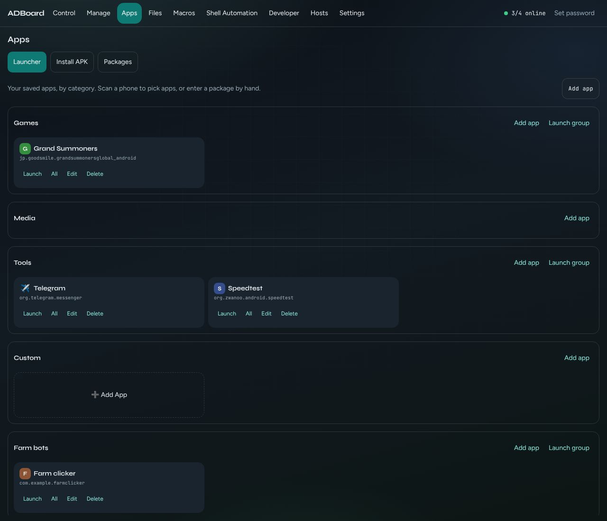
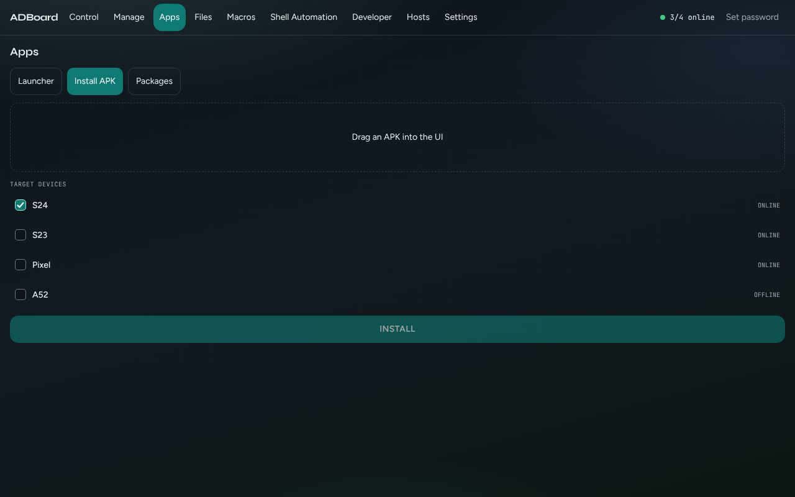
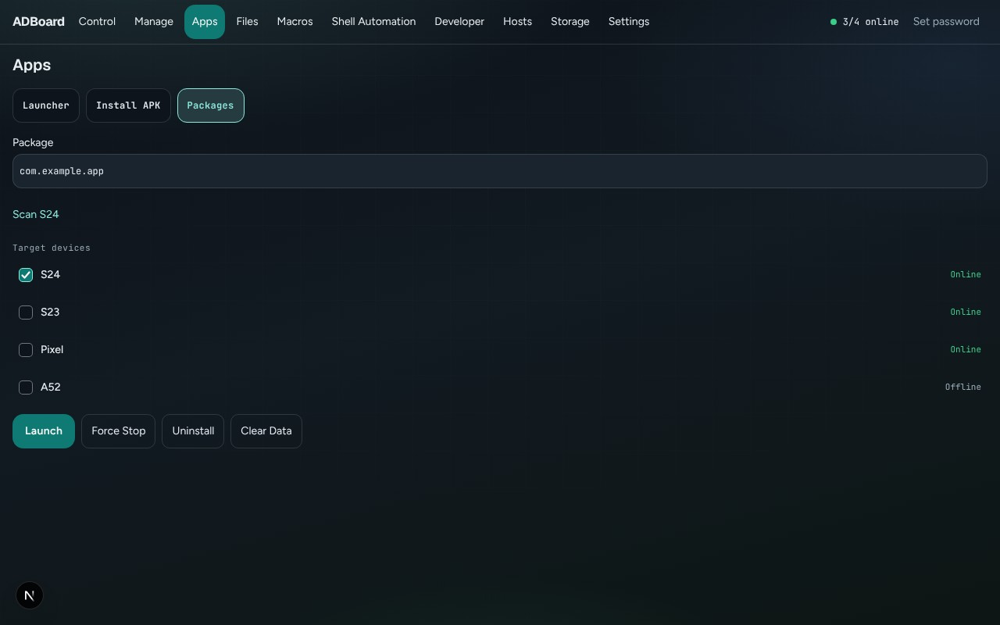

Back to the [guide index](README.md)

# Apps

The Apps tab lets you start, install and manage apps on your phones. **Launcher** keeps your own list of app shortcuts that you can start on one phone or many. **Install APK** puts an app file onto several phones at once. **Packages** lets you start, stop, remove or wipe an app by its package id.

Two terms: an **APK** is an Android app file (its name ends in .apk). A **package id** (also called package name) is an app's unique name, such as `com.android.chrome`.

## Contents

- [Launcher](#launcher)
- [Install APK](#install-apk)
- [Packages](#packages)
- [How to](#how-to)
- [Good to know](#good-to-know)

The page title is **Apps**, with three buttons: **Launcher**, **Install APK** and **Packages**. The phones you ticked on the Control tab are ticked here to begin with. Every sub-tab has a **Target devices** list with tick boxes, and a result list that shows one line per phone.

## Launcher

*Launcher: shortcuts sorted into groups, each with Launch, All, Edit and Delete.*

Your shortcuts are shown in groups: **Games**, **Media**, **Tools** and **Custom**. A shortcut card shows the app's icon, its name and its package id. Shortcuts are saved with your ADBoard library (see [where ADBoard keeps your data](../storage.md)).

| Button | What it does |
|---|---|
| Launch | Starts the app on the phones ticked in Target devices. |
| All | Starts the app on every phone that is online, ignoring the ticks. |
| Edit | Opens the shortcut so you can change it. |
| Delete | Removes the shortcut from your list straight away, without asking. It does not touch the app on any phone. |
| Launch group (top right of each group, when it has shortcuts) | Starts every app in that group, one after another, on the ticked phones. Result lines are prefixed with the app's name. |
| Add App (dashed box, in the Custom group) | Opens the form to create a new shortcut. |

### Shortcut icons

- If you type an icon (an emoji or a short symbol) it is always used.
- If the Icon field is empty, ADBoard reads the app's own icon from the phone once and remembers it. A phone must be connected the first time. This uses the phone you are looking at if it is online, otherwise the first online phone.
- If the icon cannot be read, you see a coloured badge with the first letter of the app's name. The colour is always the same for the same app. ADBoard tries again about a minute later.

### The Add App / Edit app form

| Field | What it does |
|---|---|
| Device | Which phone to use when scanning (it starts on the first online phone). |
| Scan installed applications | Lists the apps installed on that phone. Once the list is shown, an **Application** drop-down appears. |
| Application | Picking an app fills in Package, suggests a Name (the last part of the package id, if Name is empty) and tries to find the app's main Activity. |
| Name | The label on the card. If left empty, the package id is used. |
| Icon (optional: empty uses the app's own icon) | See "Shortcut icons" above. |
| Package | The package id. Required to launch. |
| Activity | Optional. A specific screen inside the app to open, for example `com.example.grandsummoners.MainActivity`. Empty means open the app normally. |
| Arguments | Optional extra settings passed with the activity, such as `--es user bob`. Only used if Activity is filled in. |
| Group | Games, Media, Tools or Custom. |
| Save / Cancel | Save the shortcut, or close without saving. |

## Install APK

*Install APK: choose a file, tick phones, press INSTALL.*

| Control | What it does |
|---|---|
| Drop box ("Drag an APK into the UI") | Drag an APK file onto it, or click it to choose a file. After you choose, it shows the file name. Only files ending in .apk are accepted. |
| Target devices | Tick the phones to install on. |
| INSTALL | Installs the APK on every ticked phone. It is greyed out until a file is chosen and at least one phone is ticked. |

The result list shows "Installed" with a tick for each success, or the reason for a failure. If the app is already on the phone it is updated in place and keeps its data. Phones you did not tick show "Skipped".

Big files: files over 64 MB are sent to ADBoard in 32 MB pieces automatically, so you do not need to do anything. The largest file ADBoard accepts is 256 MB. Large installs can take a while; leave the page open until a result appears.

## Packages

*Packages: act on one app by its package id.*

| Control | What it does |
|---|---|
| Package | The package id to act on. It starts as `com.example.app`, which is only a placeholder; replace it. |
| Scan <phone name> | Lists the apps on the phone you are looking at and puts the first one in the Package box. It does not show the whole list. |
| Launch | Starts the app on the ticked phones. |
| Force Stop | Stops the app if it is running. |
| Uninstall | Removes the app for the main user of each ticked phone. It does not ask first. |
| Clear Data | Wipes the app's saved data (settings, logins, game progress). It asks first. |

Clear Data shows a box titled "Clear application data?" with the package id and the text "This will remove the application's local data." Press **Clear Data** to go ahead, or **Cancel** to back out. Uninstall has no such box, so check the package id before you press it.

The package id may only contain letters, numbers, dots and underscores, and must have at least one dot. Anything else is refused with "package name is not valid".

## How to

### Add an app shortcut

1. Open Apps, then **Launcher**.
2. Press **Add App** in the Custom group.
3. Choose a Device that is online and press **Scan installed applications**.
4. Pick the app in the **Application** drop-down. Package, Name and Activity fill in.
5. Optionally change Name, type an Icon, or change Group.
6. Press **Save**. The card appears in its group.

### Start an app on several phones

1. In **Launcher**, tick the phones in Target devices (at the bottom of the page).
2. Press **Launch** on the app's card. To start it on every online phone instead, press **All**.

### Install an APK on several phones

1. Open **Install APK** and drop the file onto the box.
2. Tick the phones.
3. Press **INSTALL** and read the result list.

### Wipe an app's data

1. Open **Packages** and type the package id (or press Scan to fill one in).
2. Tick the phone.
3. Press **Clear Data**, check the id, and press **Clear Data** in the box.

## Good to know

- Nothing happens on phones you have not ticked, except **All**, which uses every online phone.
- Offline phones are never sent commands. A ticked offline phone shows "No result" in the result list; if every ticked phone is offline, an install reports "no online targets for install".
- The activity and arguments are checked for safety. Characters such as ; | & $ quotes and backslashes are refused in arguments.
- Delete on a shortcut and Uninstall in Packages act immediately. Clear Data is the only action here that asks first.
- On the demo phones, Install reports "Installed" without doing anything, Scan shows a short sample list (Settings, Chrome, YouTube, Camera), and Launch, Force Stop, Uninstall and Clear Data report that ADB is not available. Real results need a real phone and ADB.
