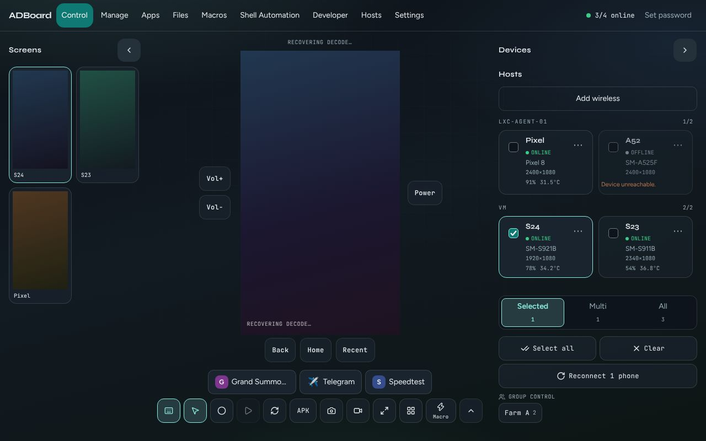
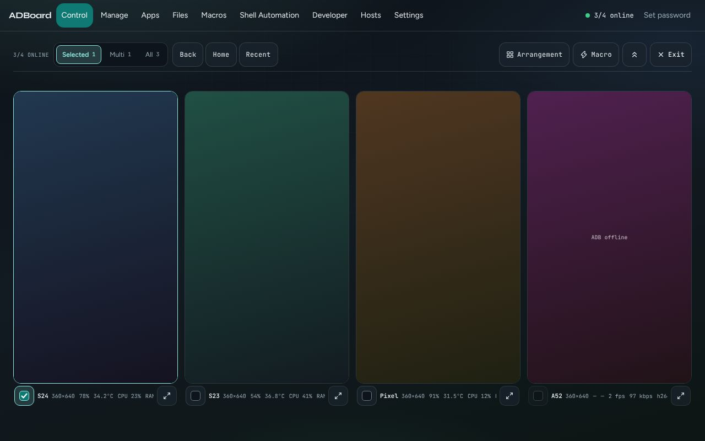
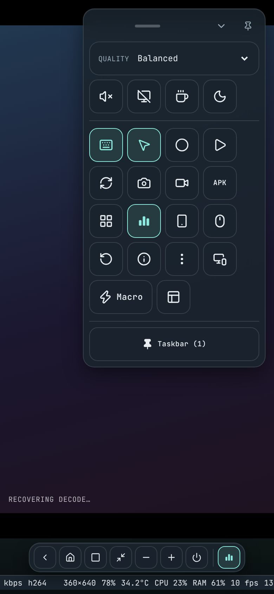
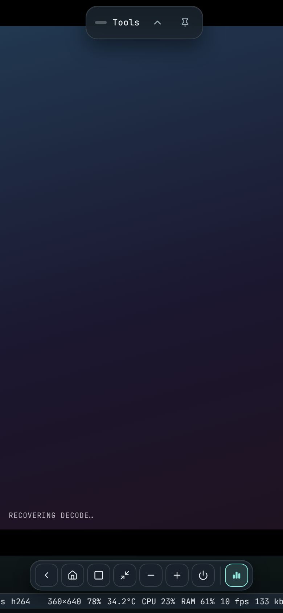

# Control

**Control** is the first tab in ADBoard and the one you will use most. It shows a live picture of an Android phone and lets you tap, swipe and type on it from your computer or from another phone. You can drive one phone, a few ticked phones, or every online phone at once. Around the picture you get buttons for Back, Home and Recent, volume and power, screenshots, stream quality, your saved apps, and a Grid view that shows all your phones as tiles. On a phone-sized screen the same tools move into a floating **Tools** panel and a bottom taskbar.

## Contents

- [What you see on screen](#what-you-see-on-screen)
- [Controlling the phone](#controlling-the-phone)
- [Who gets your input: Selected, Multi and All](#who-gets-your-input-selected-multi-and-all)
- [The tool row](#the-tool-row)
- [More tools (the ^ button)](#more-tools-the--button)
- [App shortcut buttons](#app-shortcut-buttons)
- [Grid view](#grid-view)
- [Folding the side panels](#folding-the-side-panels)
- [Fill window](#fill-window)
- [Macro panel](#macro-panel)
- [Keyboard shortcuts](#keyboard-shortcuts)
- [The phone-sized layout](#the-phone-sized-layout)
- [The stats line](#the-stats-line)
- [What needs real phones](#what-needs-real-phones)

## What you see on screen

On a desktop-sized window (1024 pixels wide or more) Control has three columns.

*The main Control view with the demo phones.*

| Area | What it holds |
|---|---|
| **Screens** (left column) | A small live picture of every online phone. Click one to show it in the big view. Offline phones are not listed; if none are online it says "No online screens". |
| **Phone view** (middle) | The big live picture of the chosen phone. **Vol+** and **Vol-** sit on its left, **Power** on its right. Under it are **Back**, **Home** and **Recent**, then your app shortcut buttons, then the tool row. |
| **Devices** (right column) | A card for every phone, then the control mode switch, **Select all**, **Clear**, **Reconnect** and any saved groups. |
| **Stats line** (bottom of the window) | One line of live numbers for the chosen phone. See [The stats line](#the-stats-line). |

The top of the window shows the section tabs (Control, Manage, Apps and so on) and an "online" counter, for example "3/4 online". If sign-in is turned on you also see your user name and **Sign out**.

### Device cards

Each card in the Devices column shows:

- a tick box (see [Multi](#who-gets-your-input-selected-multi-and-all)),
- the phone's name,
- its state: **Online**, **Offline** or **Unauthorized**,
- its model and screen size,
- battery and temperature when known,
- a **...** button (also opens on right-click) with a menu of actions for that phone, such as Reconnect, Restart ADB, Reboot, Shutdown, Screenshot, Install APK, Open Shell and Device Information.

If a phone is unauthorized, the card says "Authorize USB debugging on the device." If it cannot be reached, it says "Device unreachable."

Click a card to make that phone the one you see and control. Ctrl-click, Shift-click or Cmd-click adds or removes it from the ticked set.

Above the cards, **Add wireless** lets you connect a phone over Wi-Fi without a cable. It guides you through pairing with a QR code, or with a pairing port and code, using Android's Wireless debugging. If your phones come from more than one computer, the cards are grouped under that computer's name.

### What the phone view can show

- The live picture, once the first video frame arrives. Until then you may see "Waiting for keyframe..." or "Connecting video...".
- For an offline or unauthorized phone, an overlay with the reason and a **Reconnect** button.
- If the video drops, a "Stream error" notice. Press **Refresh** or use Reconnect.
- A thin red ring around the picture while you are recording touches.

## Controlling the phone

ADBoard talks to phones through ADB (Android Debug Bridge), Android's standard tool for controlling a phone over USB or Wi-Fi. You do not need to use it yourself.

| You do this | What happens on the phone |
|---|---|
| Click (or tap) on the picture | A tap at that spot. A small ring shows where you clicked. |
| Click and drag | A swipe or scroll. Press, drag and release. The mouse wheel is not sent to the phone, so scroll by dragging. |
| Move the mouse over the picture | In **Cursor** mode, the phone's pointer follows you (see below). |
| Type on your keyboard | The text goes to the phone, as long as **Keyboard** is on. |

Only the left mouse button is used. Taps and swipes are sent live while you drag.

### Keyboard switch

**Keyboard** is on by default. While it is on, what you type on your computer is sent to the phone instead of the page:

- Letters, numbers and symbols are typed as text.
- Backspace, Enter, Esc, Tab, the arrow keys, Delete, Home, End, Page Up and Page Down are sent as keys.
- Ctrl, Alt or Cmd combined with a letter or number is sent as a key combination.
- Browser keys stay with the browser: F5, F11, F12, and Ctrl/Cmd with R, W, L, T, N, Q or Tab.
- The Alt+Shift shortcuts listed [below](#keyboard-shortcuts) are never sent to the phone.
- Typing inside a text box on the page (for example the Clipboard box) is not sent.

Turn **Keyboard** off when you want to use your keyboard for the page only.

### Touch switch

**Touch** is on by default. When it is off, clicking and dragging the picture does nothing, so you can look without touching. Starting **Record** turns Touch on for you.

### Cursor mode

**Cursor** (in More tools) sends every click as a mouse click instead of a finger. Android then shows a mouse pointer on the phone, and moving your mouse over the picture moves it. Without Cursor mode, a mouse still works, but a touchscreen is treated as a finger.

## Who gets your input: Selected, Multi and All

The control mode decides which phones receive your taps, swipes, typing, Back/Home/Recent, volume and power, and screenshots.

| Mode | Who gets your input |
|---|---|
| **Selected** | Only the phone you are looking at. The counter under the word always shows 1. |
| **Multi** | The phones whose tick box is ticked. The counter shows how many are ticked. |
| **All** | Every online phone. The counter shows how many are online. |

Offline phones never receive input, in any mode.

The switch sits in the Devices column (and in the Grid view bar). Below it:

| Button | What it does |
|---|---|
| **Select all** | Ticks every online phone and switches to Multi. |
| **Clear** | Unticks everything and goes back to Selected. |
| **Reconnect** (shows the count, for example "Reconnect 2 phones") | Restarts the live screen on the target phones. Ticked phones that have gone offline get an ADB reconnect instead. A short note under the buttons says how it went. |

Ticking a tick box, or Ctrl/Shift/Cmd-clicking a card or screen tile, adds a phone to the ticked set. If you were in Selected mode, ADBoard switches to Multi for you.

### Group control

If you have saved groups of phones (in the **Shell Automation** tab, under Groups), a **Group control** row appears under the buttons, with one button per group and the number of phones in it. Click a group to tick exactly that group's phones and switch to Multi. The group button is lit while it matches your ticked set.

The mode and the ticks only affect where input goes. The big picture always shows one phone, the highlighted one.

## The tool row

The row of buttons under the phone. On a wide window each button shows a text label; on a narrower one only the icon is shown (hover for the name).

| Button | What it does |
|---|---|
| **Keyboard** | Turns typing into the phone on or off. See above. |
| **Touch** | Turns tapping and dragging on the picture on or off. |
| **Record** | Starts recording your touches on the picture. The button changes to **Stop** and a counter shows how many touch points were captured. Stopping saves the recording as a macro named "Touch 1", "Touch 2" and so on, in a folder called Recorded. |
| **Replay** | Plays the latest recording back on the target phones. It shows "Playing" while it runs. It is greyed out until you have a recording. If you have more than one, a small list appears under the phone so you can pick which one to replay. |
| **Refresh** | Drops the video and starts it again. Use it when the picture freezes or looks broken. |
| **APK** | Opens a file picker. Choose an .apk file and ADBoard installs it on the target phones. A note under the phone says how it went. |
| **Shot** | Takes a screenshot of each target phone and downloads each one to your computer as a PNG named after the phone. |
| **Rec** | Starts a screen recording on the phone itself (720p, in the phone's Movies folder). The button changes to **Stop**. The video file stays on the phone. |
| **Fill** | Makes the phone view fill the whole window. See [Fill window](#fill-window). |
| **Grid** | Switches to Grid view. See [Grid view](#grid-view). |
| **Macro** | Opens or closes the [Macro panel](#macro-panel). |
| **^** (More) | Opens the More tools panel above the row. See the next section. |

**Back**, **Home** and **Recent** sit above the tool row, with **Vol+**, **Vol-** and **Power** beside the picture:

| Button | What it does |
|---|---|
| **Back** | Android's Back button. |
| **Home** | Android's Home button. |
| **Recent** | Android's Recent apps button. |
| **Vol+** / **Vol-** | Volume up and down. |
| **Power** | The phone's power button (turns the screen off or on). |

These are greyed out when the phone is offline.

## More tools (the ^ button)

The **^** button at the end of the tool row opens a panel with stream options and device actions. Press it again, click outside, or press Esc to close it. On a desktop window you can also open it with Alt+Shift+M.

### Stream options

| Control | What it does |
|---|---|
| **Quality** | Low, Balanced, High, Original or Custom. A line under the controls shows what the choice means: Low is 720 px, 1 Mbps, 15 fps; Balanced is 1280 px with the default rate; High is 1920 px, 8 Mbps, 60 fps; Original is native size, 16 Mbps, 60 fps. A higher setting looks sharper but uses more bandwidth. |
| **Custom** fields | When Quality is Custom: **Max size px** (longest side, 0 to 4096, 0 means the phone's own size), **Bitrate Mbps** (0.25 to 40), **FPS** (5 to 120), then **Apply**. Values outside the range are corrected for you. |
| **Size** | Changes the screen size of every online phone: **Each phone** (back to normal), **900×1600**, **16:9**, **20:9**, or **900×1600 · 320 dpi**. This really changes the phone's display size, which is useful for matching macros made on one size. Streams restart afterwards. |
| **Audio** | Plays the phone's sound on your computer. |
| **Screen off** | Turns the phone's own screen off while you keep controlling it. |
| **Stay awake** | Stops the phone from going to sleep while connected. It does not turn the screen off. |
| **Quiet mode** | Turns the screen off and mutes the sound on every online phone, not only the targets. |
| **Clipboard** box, **To phone**, **From phone** | Type or paste text in the box and press **To phone** to paste it on the phone. **From phone** copies the phone's clipboard into the box (and your computer's clipboard). |
| **Sync clipboard** | When on, anything copied on the phone lands on your computer, and Ctrl/Cmd+V on your computer pastes your computer's clipboard on the target phones. |

A short note appears at the bottom when something fails or finishes.

### Device actions

| Button | What it does |
|---|---|
| **Cursor** | Cursor mode, described above. |
| **Restart device** | Reboots the target phones. A confirmation box lists them first; for more than one phone you must type "restart" to confirm. |
| **Device info** | Opens the Manage tab's info page for the current phone. |
| **Arrangement** | Opens Grid view with the Arrangement strip showing. |
| **Rotate** | Turns the phone a quarter turn. Needs the live screen. |
| **Fullscreen** | Makes your browser go fullscreen (Esc leaves). This is different from Fill, which only resizes inside the page. |
| **Pop out** | Opens a small always-on-top window of the phone. In Chrome and Edge you can tap and drag the picture in that window to control the phone. Other browsers get a view-only picture-in-picture window. It needs a live picture. |

Then, after the label **Device actions**:

| Button | What it does |
|---|---|
| **Reconnect video** | Restarts the live screen session. |
| **Restart ADB link** | Reconnects ADB for the phone. |
| **Power off** | Shuts the phone down, after a confirmation (type "power off" when it affects more than one phone). |

These actions go to the current targets (see [Selected, Multi and All](#who-gets-your-input-selected-multi-and-all)) and skip offline phones. A line under the phone reports the result, with a **dismiss** link.

## App shortcut buttons

Under the phone, above the tool row, you get one button per app saved on the **Apps** tab. Click a button to launch that app on the target phones. A note says "Opened <app>" or shows the error. The row scrolls sideways if you have many. It is hidden in Grid view and when no apps are saved.

Each button shows an icon and the app's name. The icon is chosen like this:

1. If you typed an icon (for example an emoji) when saving the app, that is used.
2. Otherwise, ADBoard reads the app's own icon from the phone.
3. If neither works (for example the phone is off, or the app has no readable icon), you get a coloured badge with the app's first letter.

Hover over a button to see the app's package name.

## Grid view

Grid view shows every phone as a live tile, so you can watch and drive many phones at once. Open it with the **Grid** button, with Alt+Shift+G, or from More tools -> **Arrangement**. Leave it with **Exit** in the bar or the same shortcut. While Grid view is open, the Screens and Devices columns and the tool row are hidden.

*Grid view: the bar on top, one tile per phone, and the strip under each tile.*

### The grid bar

| Control | What it does |
|---|---|
| **N/M online** | How many phones are online (hidden on small windows). |
| **Selected / Multi / All** | Who gets your touches (see below). |
| **Back**, **Home**, **Recent** | Send that button to the target phones. Desktop windows only. |
| **<** and **>** with a page number | Move between pages when you have more phones than cells (only when a fixed arrangement is set). |
| **Arrangement** | Opens the Arrangement strip. When a fixed layout is set it shows the size, for example "2×3". |
| **Macro** | Opens or closes the [Macro panel](#macro-panel). |
| **Double chevron up** (Hide grid controls) | Hides the bar so the tiles get the full height. A round button with a slider icon appears in the top right corner; hover it to see **Controls** and click it to bring the bar back. |
| **Exit** | Leaves Grid view. |

On a phone-sized screen the bar is two short rows: the mode switch on top, then the actions.

### Arrangement strip

The strip opens under the bar. Tiles shrink to make room instead of being covered.

| Control | What it does |
|---|---|
| **Fit all** | Automatic layout: every phone fits on screen and the grid picks the best number of columns and rows. |
| **Columns** and **Rows** | Plus and minus buttons for a fixed layout, from 1 to 8 each. When a layout is fixed, the grid shows only that many tiles per page and adds pages. When you are on Fit all, the numbers shown are what the grid chose. |
| **X** (Close arrangement options) | Closes the strip. Esc closes it too. |

Your arrangement and whether the bar is hidden are remembered in this browser.

### Tiles and who gets touches

Every phone is shown, including offline ones, which say "ADB offline". Under each picture is a strip with an **Include** tick box, the phone's name and a short stats line, and a **Focus** button (the expand arrows) that closes the grid and shows that phone in the normal view. Nothing covers the picture.

What your touches do depends on the mode:

| Mode | What a touch on a tile does |
|---|---|
| **Selected** | Goes only to the phone you touched. |
| **Multi** | A touch on a ticked (highlighted) tile goes to all ticked phones. A touch on an unticked tile goes only to that phone. |
| **All** | A touch on any online tile goes to every online phone. |

Hover over the mode switch to see this explained for your current state, such as "Touch on a highlighted tile goes to 2 phones" or "No phones checked - tick Include on a tile". Ticking **Include** in Multi adds or removes a phone from the group. In All mode, unticking a tile means "all except this one": the other online phones are ticked and the mode switches to Multi.

## Folding the side panels

On a desktop window, the **Screens** and **Devices** columns can be folded to give the phone more room.

- Click the arrow button in a column's header to fold it. It turns into a thin tall strip with the name and a count. Click the strip to open it again.
- Or use Alt+Shift+[ for Screens and Alt+Shift+] for Devices.

When a column is folded, the freed space is used for the controls: the Back/Home/Recent row, the app shortcuts, the tool buttons and the stream options all move into that column, one below another, with text labels, so the phone gets the full height. The More tools panel is not needed there, because its options are shown directly. If both columns are folded the controls go to the right. The fold state is remembered.

While the Devices column is folded you cannot reach the Selected / Multi / All switch there. Use the Grid view bar, or unfold Devices.

## Fill window

**Fill** (or Alt+Shift+F) makes the phone take over the whole window and hides the section tabs, the Screens column and the Devices column. Back, Home, Recent, Vol-, Vol+ and Power form one row under the picture, followed by icon buttons: Refresh, Keyboard, APK, screenshot, screen recording, Screens (opens a list of phones), Grid, Record and Replay, and **Exit fill** to come back. The stream options and device actions appear under that row. Fill is available on desktop windows only. On a phone-sized screen the view always fills.

## Macro panel

**Macro** opens a panel for the phone you are controlling, next to the picture on a desktop window and as a full-screen sheet with a **Close** button on a phone-sized screen. It shows that phone's own macro, a live view, and **Start**, **Pause** and **Stop** for it. Other phones and the Macros page are not affected. Editing macros is done in the Macros tab. See [macros.md](macros.md) for everything about macros.

The Macro button is available in the tool row, the Grid view bar and the phone-sized Tools panel.

## Keyboard shortcuts

These work in a desktop-sized window on the Control tab. They use Alt+Shift (Option+Shift on a Mac), so they still work while Keyboard is sending plain keys to the phone, and they are never sent to the phone. Hover over a button to see its shortcut.

| Keys | Action |
|---|---|
| Alt+Shift+B | Back |
| Alt+Shift+H | Home |
| Alt+Shift+R | Recent |
| Alt+Shift+G | Grid view on or off |
| Alt+Shift+F | Fill window on or off (not in Grid view) |
| Alt+Shift+M | More tools (open or close) |
| Alt+Shift+[ | Fold or unfold the Screens panel |
| Alt+Shift+] | Fold or unfold the Devices panel |

Back, Home and Recent do nothing when the phone is offline. The fold shortcuts work only while the side columns are shown.

## The phone-sized layout

When the window is under 1024 pixels wide, as on a phone, the picture fills the screen and the tab bar is hidden. A floating **Tools** panel and a bottom taskbar replace the buttons around the picture. There is no row of app shortcut buttons in this layout.

*The phone-sized layout with the Tools panel open.*

### Bottom taskbar

Always shown at the bottom:

| Button | What it does |
|---|---|
| **Back**, **Home**, **Recent** | Android's buttons. |
| **Minimize** (arrows pointing in) | Folds the Tools panel to a small chip. |
| **Volume down** (minus), **Volume up** (plus) | Volume. |
| **Power** | The phone's power button. |

After a thin divider come any tools you have pinned (below). The bar scrolls sideways if you pin many. Back, Home, Recent and Minimize are always shown. Volume down, Volume up and Power can be hidden in **Settings → Phone taskbar**, under **Show on the bar**. The phone's own buttons (Back, Home, Recent) can't be moved or removed.

### Tools panel

The panel floats over the picture. Drag its grip bar to move it. The arrow button folds it to a small tab at the edge of the screen (tap the tab to open it again). The tab shows the word **Tools**, an icon, or both, as chosen under Settings → Control, and the pin button keeps it from being dragged. Drag the chip to a screen edge to tuck it away; tap or swipe the edge tab to bring it back. On a very short screen it starts folded.

*Tools folded to a chip. The taskbar shows one pinned tool, Stats.*

At the top of the panel:

| Control | What it does |
|---|---|
| **Quality** | Same as on desktop: Low, Balanced, High, Original or Custom. For Custom the panel shows the current values; edit them in Settings. |
| Speaker icon (Audio forwarding) | Sound from the phone on or off. |
| Monitor-off icon (Screen off) | Turns the phone's screen off while you keep control. |
| Coffee cup (Stay awake) | Keeps the phone awake. |
| Moon (Quiet mode) | Every online phone: screen off and muted. |

Then a grid of tool buttons (icons only):

| Button | What it does |
|---|---|
| Keyboard | Typing goes to the phone (on or off). |
| Touch | Touch on or off. |
| Record, Replay | Record touches and play them back. |
| Refresh | Restarts the video. |
| Camera | Screenshot of each target phone, downloaded. |
| Video camera | Starts or stops a screen recording on the phone. |
| **APK** | Install an APK file. |
| Grid | Grid view on or off. |
| Stats (bars icon) | Shows or hides the stats line. |
| Devices (phone icon) | Opens the full-screen Devices list with cards, mode switch, Select all, Clear, Reconnect and groups. Choosing a phone closes it again; **Close** leaves it. |
| Cursor | Cursor mode. |
| Restart device | Reboots the target phones, after confirmation. |
| Device information | Opens the info page for the phone. |
| Device actions (three dots) | Menu with **Reconnect video**, **Restart ADB link** and **Power off**. |
| Screen tools | Opens a small group with **Rotate**, **Fullscreen** and **Pop out**. |
| **Macro** | Opens the Macro sheet. On a phone it is an icon only; a computer also shows the word. |
| **Manage** | Opens the Manage tab. In the Tools panel the same button lists the other tabs (Manage, Apps, Files, Macros, Shell Automation, Developer, Hosts, Settings) so you can switch. |

If the Pop out or Fullscreen features are not supported by your browser, those buttons do not appear.

### Customising the taskbar

You can change which tools are on the taskbar, and their order, in two places. Both change the same list.

On a touch screen, press and hold any taskbar button for half a second to open **Settings → Phone taskbar** directly. A quick tap shows the button's name above the bar.

**From the Tools panel**

1. Open **Tools** and press **Taskbar** at the bottom of the panel (it shows how many are pinned, for example "Taskbar (3)"). This is edit mode.
2. Tap a tool icon to add it to the taskbar or remove it. A small pin badge shows on the pinned ones. While you are in edit mode, tapping an icon pins it instead of using it.
3. Press **Taskbar** again to leave edit mode. **Reset** (shown while editing) removes all pins.

**From Settings**

1. Open **Settings** and find **Phone taskbar**. Switch a tool on to add it, or off to remove it.
2. Under **Order (left to right)**, press **Up** or **Down** on a pinned tool to move it.

Each tool can be pinned once. When you reach the limit of 21 tools, the other switches are greyed out until you turn one off. Pins and the Show on the bar choices are saved on the ADBoard computer, so every browser that opens this ADBoard shows the same taskbar, and it is kept after you restart ADBoard or refresh the page.

These tools can be pinned: Keyboard, Touch, Record, Replay, Refresh, APK, Grid, Stats, Devices, Manage, Cursor, Restart device, Device info, Device actions, Rotate, Fullscreen, Pop out, Quiet mode, **Macros** (opens the Macro dock), **Screenshot** and **Screen record**. Fullscreen and Pop out only appear in browsers that support them. Stream quality and the other settings stay in the Tools panel. A dot on the Macros button means a macro is running.

### Stats on a phone

Press the **Stats** button (in Tools or pinned on the taskbar) to hide or show the stats line under the picture. It is shown by default. On a very narrow screen (under 640 pixels) the line scrolls slowly across so all of it can be read.

## The stats line

A single line of live numbers for the phone you are looking at. It sits at the bottom of the window on desktop, and under the picture in the phone-sized layout. In Grid view each tile has a shorter version under its picture.

| Item | Meaning |
|---|---|
| Size, for example 1080×2400 | The picture size of the live stream. |
| Battery | The phone's battery level, or a dash if unknown. |
| Temperature | The phone's temperature, in degrees C, or a dash. |
| **CPU** and **RAM** | Percent used. Shown only when the computer running the phone connection can report them. |
| fps | Frames per second of the live picture. |
| Rate | Video data rate, in kbps or Mbps. |
| Codec | The video format, normally h264. |
| A message | Shown only when something is wrong, for example "unauthorized - unlock USB debugging", "ADB offline - reconnect", "stream starting..." or "stream error - tap Refresh or Reconnect". |

If no phone is selected, it says "No active device".

## What needs real phones

The demo phones let you try the layout and buttons, but they have no real screen, apps or sound. These features need real phones connected by USB or Wi-Fi (with the ADB tools and the screen-mirroring server set up) and will not do anything real on the demo fleet:

- the live picture itself, taps, swipes and typing,
- Audio, Screen off, Stay awake, Quiet mode, Size and the clipboard buttons,
- Shot and Rec, and installing an APK,
- Rotate, Restart device, Reconnect video, Restart ADB link and Power off,
- app shortcuts opening apps, and app icons read from the phone (you will see letter badges instead),
- battery, temperature, CPU and RAM numbers.

Layout, folding, control modes, Grid view and its Arrangement, the taskbar and pinning, and the keyboard shortcuts work on the demo phones.
