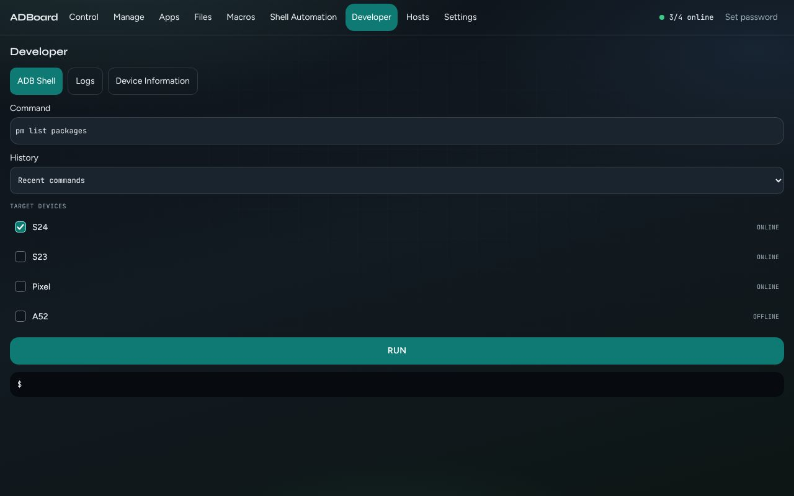
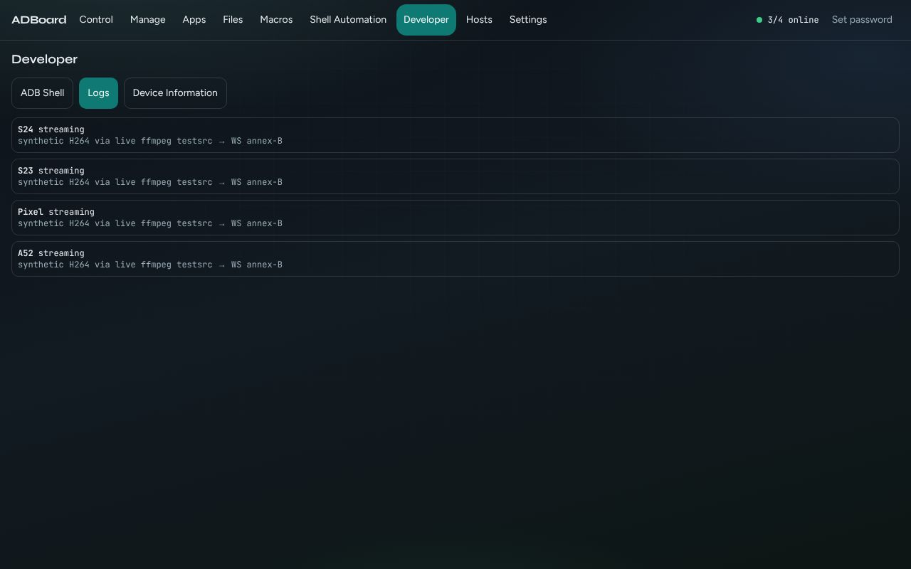
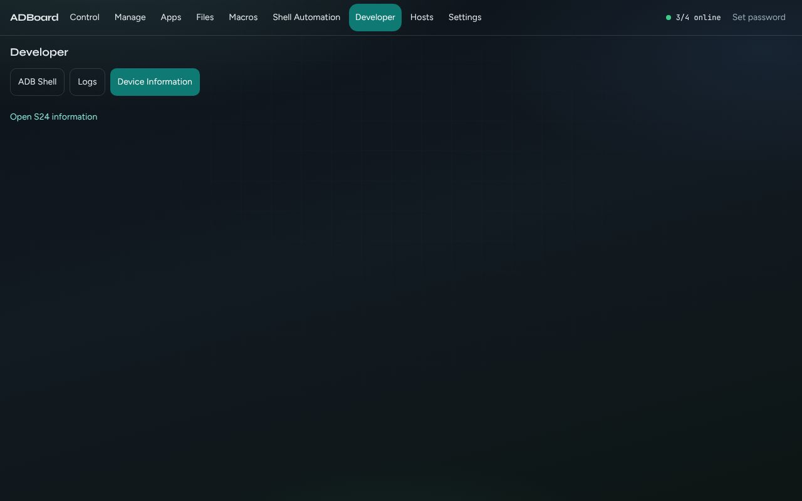

Back to the [guide index](README.md)

# Developer

The Developer tab is for people who want to look under the bonnet. **ADB Shell** runs a text command on one or more phones and shows what each one answers. **Logs** shows how each phone's live session is doing. **Device Information** takes you to the phone details page in Manage.

**ADB** (Android Debug Bridge) is the tool ADBoard uses to talk to phones. The **shell** is the phone's command line.

## Contents

- [ADB Shell](#adb-shell)
- [Logs](#logs)
- [Device Information](#device-information)
- [How to](#how-to)
- [Good to know](#good-to-know)

The page title is **Developer**, with three buttons: **ADB Shell**, **Logs** and **Device Information**.

## ADB Shell

*ADB Shell: type a command, tick phones, press RUN.*

| Control | What it does |
|---|---|
| Command | The command to run. It starts with `pm list packages` (list the installed apps). The hint shows `dumpsys battery`. |
| Recent commands (drop-down under "History") | Your last commands. Picking one puts it in the Command box; it does not run it. |
| Target devices | Tick the phones to run it on. |
| RUN | Runs the command on every ticked phone. Pressing Enter in the Command box does the same. |

Below RUN you see two things:

- The **result list**: one line per phone with a tick and the phone's answer, or a cross and the error. Phones you did not tick show "Skipped".
- A dark box that keeps a running log of this visit: each command, preceded by `$`, then one line per phone. The newest is on top, and it holds the latest 80 lines. It clears when you reload the page.

### Rules and limits

- The command must be one line. Line breaks are refused ("shell command must be a single line"), as are empty commands and commands longer than 2000 characters.
- Nothing is run on a phone that is not ticked, and nothing is run if the box is empty.
- The command runs exactly as typed in the phone's shell, so normal shell features such as pipes work. There is no list of blocked commands and no confirmation, so commands that delete or change things will do so. Take care.
- ADBoard waits for the command to finish and then shows the whole answer. Commands that never end (or that expect you to type back, like a live view) are not suited to this box.
- Recent commands keeps the last 40 different commands, newest first. They are remembered in this browser only.

## Logs

*Logs: one card per phone with its session state and latest note.*

Logs lists every phone, one card each. The card shows the phone's name, its session state (for example streaming, or its online/offline state if it has no session), and the latest note ADBoard recorded for it, such as why a stream stopped. If there is no note yet, it says "No session note yet."

This is a status view, not a stream of the phone's own system log. The View Logs button on an offline phone in Manage takes you here (see the [Manage guide](manage.md#recovery-list)).

## Device Information

*Device Information: a link into the Manage information page.*

This sub-tab shows a single button, "Open <phone name> information", for the phone you were last looking at. Pressing it opens Manage, Information, which lists the model, Android version, serial, battery, storage and more. See the [Manage guide](manage.md#information). If no phone is selected, the sub-tab is empty.

## How to

### Run a command on several phones

1. Open Developer, then **ADB Shell**.
2. Type the command, or choose one under **Recent commands**.
3. Tick the phones in **Target devices**.
4. Press **RUN** and read the result list.

### Check a phone's battery

1. Type `dumpsys battery` in the Command box.
2. Tick one phone and press **RUN**.
3. Read the numbers (such as level and temperature) in the result line.

### See why a phone is not streaming

1. Open **Logs**.
2. Find the phone's card and read its state and note.

## Good to know

- Only single-line commands are accepted, up to 2000 characters.
- There are no confirmations in the shell. Be careful with commands that remove files or change settings.
- Offline phones are not sent commands. A ticked offline phone shows "No result".
- Results can be long. The result list shows the phone's full answer on the line; the dark log box scrolls sideways.
- On the demo phones every shell command reports that ADB is not available. The shell needs a real phone and ADB.
- Phones attached to another computer are run through that computer (see the [Hosts guide](hosts.md)).
