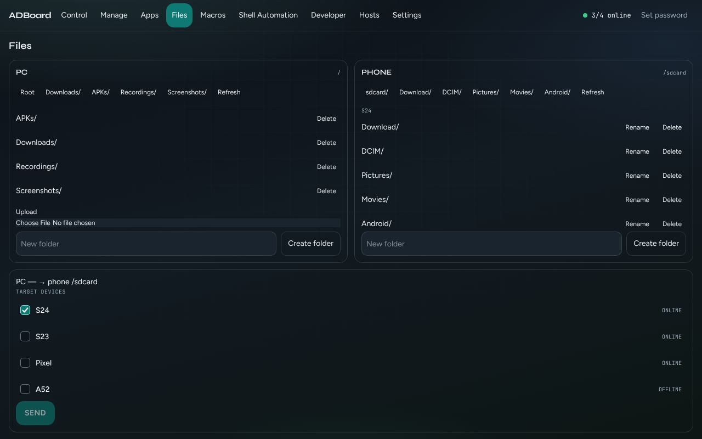

Back to the [guide index](README.md)

# Files

The Files tab moves files between the ADBoard computer (the **PC** pane) and a phone (the **PHONE** pane). You can browse both sides, upload, download, drag a file from one side to the other, make folders, rename and delete. It is also where you find the screenshots and recordings that ADBoard makes.

*Files: the PC pane and the PHONE pane side by side, with the SEND bar below.*

## Contents

- [The PC pane](#the-pc-pane)
- [The PHONE pane](#the-phone-pane)
- [Sending files to the phone](#sending-files-to-the-phone)
- [Where screenshots and recordings land](#where-screenshots-and-recordings-land)
- [How to](#how-to)
- [Good to know](#good-to-know)

## The PC pane

The PC pane shows folders on the ADBoard computer. It does not show the whole disk, only the **files folder** inside the ADBoard data folder (see [where ADBoard keeps your data](../storage.md)). The path at the top right of the pane shows where you are; "/" is the top of that files folder.

| Button | What it does |
|---|---|
| Root | Goes to the top of the files folder. |
| Downloads/, APKs/, Recordings/, Screenshots/ | Shortcuts to those four folders. ADBoard creates them if they are missing. |
| Refresh | Reads the folder again. |
| .. | Goes up one folder (shown when you are not at the top). |
| A folder name | Opens the folder. |
| A file name | Selects the file as the one to send to the phone (see SEND below). |
| Download (on each file) | Saves the file through your browser to your own computer. |
| Delete (on each row) | Deletes the file or folder from the PC at once, without asking. |
| Upload | A file chooser. The chosen file is copied into the folder you are in (or Downloads if you are at the top). |
| New folder box + Create folder | Makes a folder inside the folder you are in. |

## The PHONE pane

The PHONE pane shows the storage of one phone. Under the title, a small line names the phone ("No phone selected" if none). The phone used is the first ticked phone that is online, otherwise the phone you were last looking at.

| Button | What it does |
|---|---|
| sdcard/, Download/, DCIM/, Pictures/, Movies/, Android/ | Shortcuts to those folders on the phone (/sdcard, /sdcard/Download, and so on). |
| Refresh | Reads the folder again. |
| .. | Goes up one folder (not shown at /sdcard). |
| A folder name | Opens the folder. |
| Download (on each file) | Copies the file from the phone into the PC Downloads folder, then you can use the PC pane's Download to save it to your own computer. |
| Rename (on each row) | Asks for a new name, then renames it on the phone. |
| Delete (on each row) | Deletes the file or folder, including everything inside a folder, at once without asking. ADBoard refuses to delete /, /sdcard or /storage themselves. |
| New folder box + Create folder | Makes a folder inside the folder you are in. |

## Sending files to the phone

Under the two panes is a bar that reads "PC <file name> → phone <folder>". It shows the PC file you selected and the phone folder it will go to.

| Control | What it does |
|---|---|
| Target devices | Tick the phones to receive the file. Only online ticked phones get it. |
| SEND | Copies the selected PC file into the phone folder you have open, on every ticked online phone. Greyed out until you select a file (not a folder). |

You can also drag instead:

- Drag a PC file onto the PHONE pane to send it at once to the open phone folder (on the ticked phones).
- Drag a phone file onto the PC pane to copy it into the PC folder you have open (Downloads if you are at the top).

Folders cannot be dragged; only files can.

## Where screenshots and recordings land

- **Screenshots** taken with Manage, Screenshot, Save locally (or Copy to clipboard) are stored in the PC pane under Screenshots/<phone serial>/, one folder per phone.
- **Screenshots saved to the device** go to the phone's Pictures folder.
- **Recordings** are made on the phone, by default in Movies on the PHONE pane. To keep one on the PC, press Download next to it. It lands in the PC Downloads folder.

The PC folder named Recordings is there for your own use. ADBoard does not fill it for you.

## How to

### Put a file on a phone

1. Open Files. In the PC pane, press **Upload** to add the file (or find it if it is already there).
2. Click the file's name so it is selected. The bar below shows its name.
3. In the PHONE pane open the folder you want, for example **Download/**.
4. Tick the phone or phones in Target devices.
5. Press **SEND** (or drag the file onto the PHONE pane). The result list shows one line per phone.

### Get a photo off a phone

1. In the PHONE pane open **DCIM/** and find the picture.
2. Press **Download** beside it. It is copied to the PC Downloads folder.
3. Open **Downloads/** in the PC pane and press **Download** beside the file to save it to your own computer.

### Find a screenshot you took

1. In the PC pane press **Screenshots/**.
2. Open the folder named after your phone's serial.
3. Press **Download** next to the picture.

## Good to know

- Files folder only: the PC pane cannot leave the ADBoard files folder.
- Delete and the phone's Rename and Delete do not ask for confirmation. Deleting a phone folder removes everything in it.
- Offline phones are not used. If the open phone goes offline, the PHONE pane shows an error under its shortcut row and the list stays empty.
- Large files: files over 64 MB are sent in pieces automatically (the largest allowed is 256 MB).
- ADBoard remembers the last PC and phone folder you had open in each browser.
- Both panes show only names and folder markers, not sizes or dates.
- On the demo phones, the PHONE pane shows a sample list of folders and one very long file name, and sending, renaming, deleting and making folders need a real phone and ADB.
