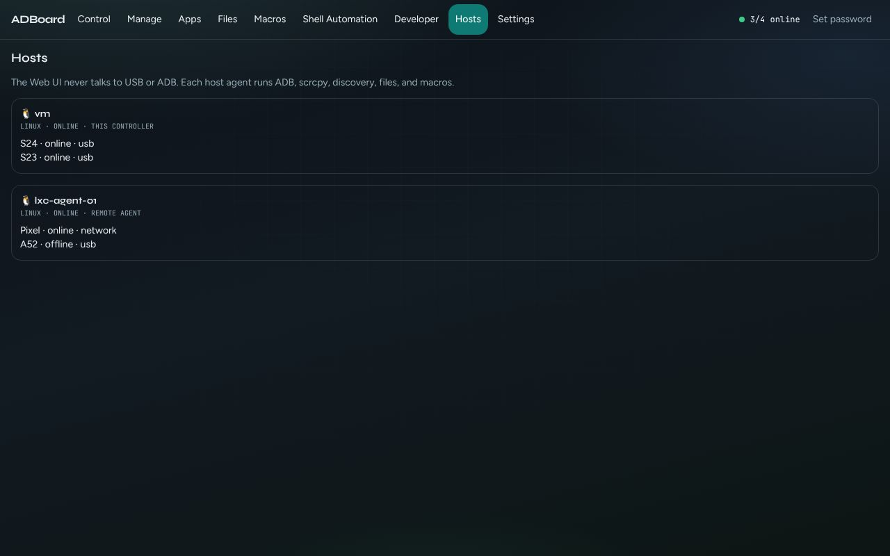

Back to the [guide index](README.md)

# Hosts

A **host** is a computer that has phones plugged in (or connected over Wi-Fi) and runs ADBoard's agent program. The agent is the part that runs ADB, the phone screen stream, file transfers and macros. The web page in your browser never talks to a phone directly. It talks to one main ADBoard, called the **controller**, and the controller passes work on to the other hosts.

The Hosts tab lists the computers ADBoard knows about and the phones on each. Use it to check what is connected. It doesn't change anything.



*Hosts: one card per computer, each listing its phones.*

## Contents

- [What the list shows](#what-the-list-shows)
- [Adding a second computer](#adding-a-second-computer)
- [How to](#how-to)
- [Good to know](#good-to-know)

## What the list shows

Under the title **Hosts** is a short note: "The Web UI never talks to USB or ADB. Each host agent runs ADB, scrcpy, discovery, files, and macros." (scrcpy is the tool that shows the phone screen.)

Each computer gets a card with:

- Its name, with a computer symbol for Windows or a penguin for Linux.
- A line with the system (windows or linux), its state (for example online), and either "this controller" (the computer your browser is connected to) or "remote agent" (another computer that joined the controller).
- A list of its phones. Each shows its name (or model code) on the left and its state on the right; **Online** is shown in green. A computer with no phones says "No devices reported."

If the list of hosts cannot be fetched, a red message shows the reason and the page falls back to grouping your phones by the host name each phone reports.

### Phone names

Each phone shows its marketing name (for example **Samsung Galaxy S24**), with the model code underneath, such as `SM-S921B`. If ADBoard does not recognise the model, only the model code is shown.

The names come from a public device list. ADBoard downloads it at most once a day and keeps it in the **Phone Models** folder of the data folder (`device\device-models.json`). If a download fails, the last good copy is kept, so names still show when the computer is offline.

## Adding a second computer

You can add a second PC or a Linux box (for example a Proxmox LXC container) so its phones show up in the same ADBoard. The second computer runs the same program in **agent** mode and connects to the controller. Phones plugged into it then appear in your device grid, and a card for it appears under Hosts.

You need, on the second computer: the ADBoard program, plus ADB and scrcpy next to it (see the project README for how to fetch them). The controller must be reachable from the second computer over the network.

On the controller (for example a Windows PC), start ADBoard so it listens on the network, not just on itself:

```
ADBOARD_ROLE=controller
ADBOARD_BIND=0.0.0.0
ADBOARD_TOKEN=<a shared secret>
```

On Windows, `run.bat` already listens on the network; allow TCP port 3848 in Windows Firewall.

On the second computer, start the agent and point it at the controller:

```
ADBOARD_ROLE=agent
ADBOARD_PORT=3849
ADBOARD_HOST=lxc-agent-01
ADBOARD_HOST_ID=lxc-agent-01
ADBOARD_CONTROLLER_URL=ws://<controller-ip>:3848/ws/agent
ADBOARD_HTTP_BASE=http://<this-computer-ip>:3849
ADBOARD_TOKEN=<the same shared secret>
```

| Setting | Meaning |
|---|---|
| ADBOARD_ROLE | `controller` (the main one your browser uses) or `agent` (a helper). |
| ADBOARD_HOST | The name shown on the card. |
| ADBOARD_HOST_ID | A stable ID for this computer. Keep it the same each time. |
| ADBOARD_CONTROLLER_URL | Where the agent finds the controller. Use the controller's network address, never 127.0.0.1 from a different computer. |
| ADBOARD_HTTP_BASE | The address the controller uses to reach this agent (needed for the screen stream). |
| ADBOARD_PORT | The port the agent listens on (3849 by default for an agent). |
| ADBOARD_TOKEN | A shared secret. Set the same value on both sides when the controller is open to the network. |


## How to

### Check that a second computer has joined

1. Start the controller, then start the agent on the second computer with the settings above.
2. Open the **Hosts** tab.
3. Look for a card with the agent's name and "remote agent". Its phones are listed under it.

### Find which computer a phone is on

1. Open **Hosts**.
2. Find the phone's name in the lists. The card it appears in is its computer.
3. The Manage, Information page also shows a Host line.

## Good to know

- The browser always connects to the controller only. You never open the agent's address in the browser.
- Anything you do to a phone on a remote agent (screenshot, install, shell, files) goes through the controller to that agent. If the agent cannot be reached the result line says so, for example "cannot reach remote host".
- An agent that is stopped or loses the network will show as not online, and its phones will be offline; commands are not sent to offline phones.
- A phone is attached to one computer. Wireless phones (see the [Manage guide](manage.md#wireless)) belong to the computer whose ADB connected to them.
- This tab is read only: there are no buttons to add, remove or restart hosts. That is done by starting or stopping the agent program on that computer.
