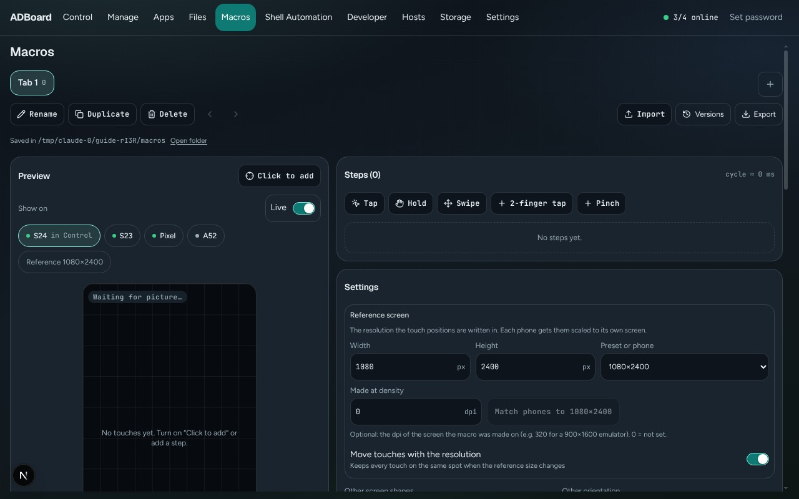

Back to the [guide index](README.md)

# Macros

A **macro** is a recorded list of finger touches that ADBoard plays back on your phones: taps, long presses, swipes and two-finger gestures, each with its own timing. You build the list in the **Macros** tab, see the touches drawn over a live picture of the phone, and press **Run**. ADBoard repeats the list as many times as you ask, on one phone or many at once.

This page covers the Macros tab: managing macros, placing touches, running them (one macro, or a different one on each phone), queues and schedules, import and export, and the Macro panel in the Control tab.

*The Macros tab. The screenshots in this guide use demo phones, so the preview shows no picture, only the numbered touch markers.*

## Contents

- [Macros or Shell Automation?](#macros-or-shell-automation)
- [Where macros run](#where-macros-run)
- [The tab bar](#the-tab-bar)
- [Preview](#preview)
- [Steps](#steps)
- [Settings](#settings)
- [Run](#run)
- [Phones: a macro for each phone](#phones-a-macro-for-each-phone)
- [Queue](#queue)
- [Schedule](#schedule)
- [Export](#export)
- [Import](#import)
- [Versions](#versions)
- [The Macro panel in Control](#the-macro-panel-in-control)
- [Worked example: tap a button every 3 seconds, forever](#worked-example-tap-a-button-every-3-seconds-forever)
- [Worked example: import an Auto Clicker config and run it on two phones](#worked-example-import-an-auto-clicker-config-and-run-it-on-two-phones)

## Macros or Shell Automation?

Use a **macro** when the job is "touch the screen here, then there, over and over". Examples: tap a button every few seconds, swipe a list, collect a daily reward, press with two fingers. A macro only touches the screen, and it can do that with exact timing.

Use [Shell Automation](shell-automation.md) when the job is about the phone rather than its screen: opening or stopping apps, installing APKs, moving files, pressing keys or running shell commands.

If a job needs both, build each part where it fits. Shell Automation can start the app, and a macro can do the tapping inside it.

## Where macros run

- Macros run on the **ADBoard agent**, the program on the computer that holds the phones. They do not run in your browser.
- A run **keeps going when you close the browser**. Any browser that opens ADBoard later sees the run and can pause or stop it.
- Runs **stop when ADBoard itself is closed**. Your macros and your phone choices are kept, but you have to start the runs again.
- Macros are saved on ADBoard and shared by every browser that opens it. If the line under the page title says "Saved in this browser only", ADBoard could not be reached and your edits are only in this browser for now. When macros are shared, no line is shown.
- If ADBoard is not connected at all (the in-browser demo), runs happen inside the browser page and end when you close it.

## The tab bar

Each macro is one **tab** at the top of the page. A tab shows its name, a small number (how many steps it has) and a pulsing dot while it is running. Click a tab to open it. You can have up to 50 macros.

- **+ (New tab)** adds a macro called "Untitled macro" and opens its name field so you can type a name straight away. Press Enter to keep the name, or Escape to leave it as it was. If you leave the field empty the old name stays.
- **Rename** opens the same name field for the open macro. Double-clicking a tab does the same. Names can be 60 characters long.
- **Duplicate** makes a copy called "<name> copy" right after the original and opens it. Editing the copy never changes the original.
- **Delete** asks you to confirm ("Delete tab"). It removes the macro and its steps, and stops it if it is running. Export it first if you want a copy. If you delete your last macro, ADBoard gives you a fresh empty one called "Tab 1".
- **Move tab left** and **Move tab right** (the two arrows) change the order of the tabs.

**Names are unique.** Every macro is its own file, so two macros cannot share a name. If you pick a name that is taken, ADBoard adds " 2" (then " 3" and so on) and tells you, for example: "Farm" is taken; renamed to "Farm 2". The check ignores upper and lower case.

**Where the file is.** Under the buttons you see, for example, "Saved in /home/you/.local/share/ADBoard/macros as Daily_Login.json". Each macro is saved as `<Name>.json` in the `macros` folder of the data folder. The **Storage** tab shows where that is. Spaces and characters Windows does not allow become `_` in the file name; the name you see in the tab stays as you typed it. **Open folder** opens that folder on the computer where ADBoard runs. See [Where ADBoard keeps your data](../storage.md) for the whole folder layout.

**If a file cannot be read.** When ADBoard starts and finds a macro file it cannot read, it keeps a copy of the file in the `backups\corrupt` folder, loads all the other macros as normal, and shows a warning in a coloured box under this line. Nothing is deleted.

At the right of the bar are **Import**, **Versions** and **Export**, described below.

## Preview

The **Preview** card shows the screen of a phone and draws your touches on it.

- **Show on** is a row of chips: one for each connected phone (with a dot that is green when the phone is online) and a **Reference** chip such as "Reference 900x1600". Click a chip to draw the touches on that phone's screen, or on a blank frame the size of the reference screen. A phone whose screen size is unknown cannot be picked. The chip of the phone you are controlling in the Control tab says "in Control". A macro opens on the phone you are controlling, otherwise on an online phone ticked in Run, otherwise on any online phone, and remembers the last chip you picked.
- **Live** is a switch that shows when a phone chip is selected. On, the phone's live picture is shown under the touch markers. Off, you only see the markers. A badge in the corner tells you the state: "Live", "Connecting...", "Waiting for picture...", "Video unavailable" or "No video (mock UI)".
- Each touch is a numbered coloured circle: the number is the step. A step with several fingers shows "1a", "1b" and so on. A swipe also has a line, and a hollow ring marks where the swipe ends. Steps you have switched off are faded. The selected step is drawn brighter.
- A caption under the picture shows the screen name and size. If the macro is set to **Keep aspect** and the phone has a different shape, a dashed outline marks the area the macro uses.
- If the phone is turned sideways compared with the macro and the macro is set to skip other orientations, a warning appears above the picture.
- While a macro runs, each touch flashes as a fading ring on this preview.

**Click to add** turns on placing mode: the button says "Click the screen..." and the next click on the picture adds a Tap step at that spot and selects it. Click the button again to turn the mode off. With no steps, the preview reminds you: "No touches yet. Turn on "Click to add" or add a step."

**Moving a touch.** Drag any marker to move it. To nudge it precisely, click a marker and press the arrow keys: 1 pixel per press, or 10 pixels with Shift held. The numbers in the step editor update as you go. The preview shows exactly where each phone will be touched, scaled the way a run will scale it.

## Steps

The **Steps** card lists the touches in order. The title shows how many ("Steps (4)") and "cycle ~ 9.1 s", the time one pass through the enabled steps takes. A macro can have up to 500 steps.

### Adding steps

The buttons above the list add a step in the middle of the screen. Each new step waits 300 ms before the next one.

| Button | What it adds |
|---|---|
| **Tap** | One finger, pressed for 50 ms |
| **Hold** | One finger, pressed for 800 ms |
| **Swipe** | One finger that slides up the screen over 300 ms |
| **2-finger tap** | Two fingers side by side, pressed for 100 ms |
| **Pinch** | Two fingers that slide apart over 400 ms |

You can also add a Tap by using **Click to add** in the Preview. Afterwards you can change anything.

### One row per step

Each row has:

- A **tick box** that switches the step on or off. A step that is off is skipped when the macro runs (the tooltip says "Skip this step" or "Play this step") and is faded in the list and in the preview.
- The step number, its name (or "Tap", "Hold", "Swipe" or "Multi-touch" if you gave none) and a summary line: where the finger goes, how long it presses and the wait after. Click the row to open its editor, and click again to close it.
- **Test step N** (the play button) plays only that step, once, on the phones ticked in Run. It is greyed out while the macro is running or when no ticked phone is online.
- **Move step up**, **Move step down** and **Duplicate step**. A duplicate is placed right after the original. On a narrow screen these three are inside the open editor instead of on the row.
- **Delete step** (the bin) removes the step.

### The step editor

Click a step to open it.

- **Name**: an optional label. If you leave it empty the step shows its kind.
- **Then wait**: how long to wait after this step before the next one, in milliseconds (0 to one hour). The screenshot above shows 3000 ms, which is 3 seconds.
- A box for each finger, titled **Touch** (one finger) or **Finger 1**, **Finger 2**... With several fingers each box has a small cross to remove that finger. Inside each box:
  - **X** and **Y**: where the finger goes down, in pixels of the reference screen (see [Settings](#settings)).
  - **Swipe** switch: when on, the finger slides to a second point. Two more fields appear, **To X** and **To Y**, and the finger moves in a straight line to there before lifting.
  - **Press time** (or **Swipe time** when Swipe is on): how long the finger stays on the screen, from 10 ms to 60 seconds.
  - **Starts after** (only when the step has more than one finger): how many milliseconds after the step starts this finger touches down. Different values let the fingers overlap instead of landing together. A small timeline under the fingers shows when each one is down.
- **Add finger (1/10)** adds another finger to the step, up to 10. All the fingers of one step play at the same time, which is how you make two-finger gestures. The step's total time is "Press time" (plus "Starts after"), and the wait comes after that.

## Settings

The **Settings** card holds what applies to the whole macro.

**Reference screen.** This is the screen size your touch positions are written in. ADBoard scales the positions to each phone's own screen when it plays them.

- **Width** and **Height** (100 to 8192 pixels).
- **Preset or phone**: pick "Custom", a common size (for example 1080x2400) or one of the connected phones to copy its size.
- **Made at density** (dpi, optional, 120 to 640): the screen density of the phone or emulator the macro was made on. Positions only scale with the resolution, but many games place their buttons by density. If a phone has the same resolution but a different density, your touches can land on the wrong button. When this number is set, **Match phones to WxH @ dpi** changes the screen size and density of the online phones ticked in Run to match, and reports the result under the button. This changes the phones' own display settings, so use it only on phones you are happy to change. Leave it at 0 if you do not need it.
- **Move touches with the resolution** (a switch, on by default): when you change the reference size, ADBoard moves every touch so it stays on the same spot of the screen. Turn it off if you want the numbers to stay as they are and the touches to move instead. The switch is not saved; it is on each time you open the page.

**Other screen shapes**: what happens on a phone whose shape differs from the reference screen.

- **Stretch**: the same relative spot on every screen (10% from the left stays 10% from the left).
- **Keep aspect**: the reference screen is scaled evenly and centered on the phone, with unused bars at the sides or top and bottom.

**Other orientation**: what to do with a phone that is portrait when the macro is landscape, or the other way round.

- **Run anyway**: the macro plays on the phone regardless. This is the default for new macros.
- **Skip phone**: the phone is left out and listed as "other orientation" in Run.

A phone reports its normal screen size, not its current rotation, so a run may not notice that a phone is turned. The preview warning uses the live picture and is more accurate.

**Random offset**: moves each touch by up to this many pixels (of the reference screen, 0 to 200) in a random direction every time. It makes the touches look less machine-exact. 0 means every touch lands exactly where you set it.

**Notes**: free text for yourself, up to 2000 characters.

If the macro came from an import, a small line at the bottom says "Imported from Auto Clicker" (or "ADBoard Automate") and the file name.

## Run

The **Run** card starts and stops the open macro.

**Phones for this tab** lists every connected phone with a tick box, its screen size and its state. **All online** ticks every online phone. A phone's state reads "online" or "offline", or "other orientation" when it would be skipped, or "in "<macro>"" when another macro is already using it. The tick boxes are locked while the macro runs. If nothing is connected it says "No phones connected."

**Repeat** decides how long the macro plays. Each time through all the enabled steps is one cycle.

- **Loop forever**: repeat until you press Stop.
- **Cycles**: play the steps a set number of times. A **Cycles** field appears (1 to 1,000,000). New macros start with 10.
- **For time**: repeat until the time is up. A **Seconds** field appears (1 second up to 7 days). A pause does not use up the time.

Repeat cannot be changed while the macro runs.

**The Run button** says what will happen:

- "Run forever on 2 phones"
- "Run x10 on 1 phone"
- "Run for 5 min on 3 phones"

The number counts the ticked phones that are online. The button is greyed out, with a hint under it, when nothing is ready: "Add or enable a step to run." or "Tick at least one online phone."

When you press it, ADBoard starts one independent run on each ticked online phone. Phones that cannot start are skipped and listed with the reason, for example "Busy" when another macro is already using that phone, or "Skipped" for an offline phone. If the start is refused, a message appears under the button.

**While it runs** the button becomes **Stop**, and **Pause** appears next to it.

- **Pause** waits until the touch in progress is finished, then holds before the next step. The phones stay reserved for this macro. The button changes to **Resume**, which continues from the next step.
- **Stop** ends the run after the touch in progress, which always lifts every finger. The button says "Stopping..." for a moment.

**The status area** under the buttons shows the state (RUNNING, PAUSED, STOPPING, DONE, STOPPED or FAILED), the cycle ("cycle 3/10", or "cycle 3 - infinity until stopped"), the step ("step 2/4"), how many touches were sent, the seconds elapsed and, for For time, the seconds left. A progress bar follows the current step. Below that is one line per phone: Waiting, Touching, Failed, Skipped, Busy or "Mock (not sent)" when the phone is a pretend one, with the reason where there is one.

If a phone fails (for example it is unplugged) only that phone leaves the run; the others carry on. If every phone fails the run ends as FAILED.

Editing a macro while it runs does not change the run in progress. The change counts from the next run.

## Phones: a macro for each phone

The **Phones** card lets every phone play its own macro, independently. Use it when different phones have different jobs, for example one phone collects rewards while another farms.

For each connected phone you see its name, whether it is online, and:

- A list called "Macro for <phone>" with **No macro** or any of your macros. The choice is saved on ADBoard, so it survives refreshes, reconnects and restarts. It is locked while the phone runs. If the macro you chose has been deleted, the list says "(deleted macro)".
- **Start "<macro name>"**. It plays that macro on this phone only, using the macro's own Repeat setting and settings. This does not use the ticks in the Run card.
- While the phone runs: **Pause** / **Resume** and **Stop**, just like in Run, for this phone only.
- A status line with the state, the macro name, the cycle, the step and the number of touches, plus the last message once the run has ended.

Under the title:

- **Start all** starts every online phone that is not already running and has a macro with at least one enabled step.
- **Stop all** stops every run.

The rules for sharing phones:

- A phone plays **one macro at a time**. Pressing Start on a busy phone is refused with a message that says which macro it is running.
- Runs on different phones are independent. Stopping, pausing or unplugging one phone does not touch the others.
- A phone that is offline cannot be started ("Offline: connect the phone to start."). A macro with no enabled steps cannot be started either.
- The Run card's button and the Phones card use the same phones. Starting a macro with Run on a phone that is already busy skips that phone and shows "Busy".

## Queue

The **Queue** card plays several macros one after another, each on the phones that are ticked in that macro.

- **Add "<name>"** puts the open macro at the end of the queue. You can add the same macro more than once.
- Each line has **Move up**, **Move down** and **Remove from queue**. **Clear** empties the queue. These are locked while the queue runs.
- **Run queue** starts at the top. Each macro plays until its own stop condition (its Repeat setting), then the next one starts. When a macro fails, the queue notes it and moves on. A macro that is deleted is skipped. **Stop queue** ends the queue after stopping the run in progress.
- Each line shows its state: waiting, running, done, stopped, failed or skipped. Hover over the state to see the detail.
- A macro set to **Loop forever** never ends by itself, so the queue stays on it until you press Stop. Use Cycles or For time for macros you want to queue.

The queue runs on the ADBoard agent, so it keeps going when the browser closes.

## Schedule

The **Schedule** card starts a macro or the queue at a set time, even when no browser is open. It runs on the ADBoard agent, so ADBoard itself must be running at that time.

To add a schedule:

1. **Play**: pick one of your macros, or "The queue".
2. **Repeat**: **Once** or **Every...**.
3. **At** (for Once) or **Starting** (for Every...): the date and time. It starts five minutes from now.
4. **Minutes** (only for Every...): the gap between runs, from 1 to 1440 minutes. It starts at 30.
5. Click **Add**.

**Once** runs at that moment one time. **Every...** runs at the starting time and then again every N minutes after it.

Each schedule appears in a list with a switch to turn it on or off, the macro it plays, "once" or "every N min", and when it runs next ("Next 14:30"), or "Off" or "Done". After a run it shows the time and result. **Delete schedule** removes it.

If ADBoard was off at the scheduled time, the missed run happens once when it is back. Missed runs do not pile up.

A scheduled macro plays on the phones ticked in that macro. If a phone is busy or offline, it is skipped.

## Export

**Export** (top right) saves your macros to a file that you can keep, share, or import on another ADBoard. Chrome and Edge ask where to save it; other browsers download it.

| Choice | File |
|---|---|
| **This tab** | `<Name>.json` (for example `Daily_Login.json`) |
| **All tabs** | `adboard-macros.json` |
| **This tab for Auto Clicker** | `<Name>-autoclicker.txt` |
| **All tabs for Auto Clicker** | `autoclicker-config.txt` |

The two ADBoard files keep everything. The two Auto Clicker files use the format of the Android app Auto Clicker, so you can use your macros there too. Auto Clicker plays one touch at a time, so a step with several fingers is split into one touch per finger, and ADBoard tells you after the export. Steps that are switched off are left out.

## Import

**Import** (top right) opens a file picker for `.json` and `.txt` files up to 20 MB. ADBoard looks at the contents, not the file name, so a renamed file still works. It reads:

- **ADBoard macros**: a file made by Export, one macro or many.
- **Auto Clicker configs**: the `config.txt` that Auto Clicker exports. Each configuration becomes a macro.
- **ADBoard Automate macro (older)** and **ADBoard desk export (older)**: touch steps from old ADBoard versions. Steps that are not touches (apps, files, shell commands) are not imported.

Nothing is saved yet. The **Import macros** window first shows the file name, what kind of file it is, how many macros and steps it has (and how many multi-touch steps), the names of the macros and any notes about things ADBoard had to repair or skip. A file that is empty, cut off or not a macro file is refused with the reason, and your macros stay as they are.

**Screen it was made on.** Auto Clicker files store pixel positions but not the screen size. For them (and for the older formats) the window shows this box: "Guessed 900x1600 from the furthest point." ADBoard picks the smallest common phone size that holds every touch. If the guess is wrong, type the width and height, or click a preset or one of your connected phones, and touches are scaled to match. Pick the size of the phone or emulator the config came from.

**Into this browser's tabs**:

- **Add as new tabs** (the default) keeps your macros and adds the new ones. A new macro whose name is taken gets " 2". The first imported macro opens.
- **Replace all tabs** removes all your current macros and puts the imported ones in their place, without asking again. If you do this by mistake, use [Versions](#versions) to get them back.

Then click **Import** (or **Cancel**). A message tells you how many macros arrived. There is room for 50 macros in total; if some do not fit, the message says how many were left out.

Auto Clicker settings are carried over like this:

- A click becomes a short tap.
- A swipe becomes a Swipe step (an Auto Clicker swipe with no length uses 500 ms).
- The delay of each target becomes "Then wait".
- The stop condition becomes Repeat: Loop forever, For time or Cycles.
- "Anti-detection" becomes a Random offset of 12 pixels.

## Versions

**Versions** (top right) lets you go back to an earlier state of your macros. It lists two groups:

- **Saved on ADBoard**: the last 20 saved states on ADBoard, newest first, each with its date and the number of macros in it.
- **Kept in this browser**: backups this browser made for itself, for example just before a newer shared copy replaced its own.

Click an entry to restore it. A message confirms what came back. A restore is itself a new version, so you can undo it by opening Versions again and choosing the state from just before. If a list is empty it says "No earlier versions yet." or "None.". If ADBoard cannot be reached, the menu says "ADBoard is not reachable".

## The Macro panel in Control

You do not have to leave the Control tab to run a macro. The **Macro** button in the Control tool row opens the **Macros** panel next to the phone. On a wide screen it appears as a side panel (it takes the place of the phone list until you close it); on a small screen it opens as a full-screen sheet with a **Close** button. The panel is for running macros. To edit one, use the Macros tab.

When a phone is selected in Control, the panel belongs to that phone and is titled "Macros . <phone name>", with its online state. It contains:

- **Macro for <phone>**: that phone's own macro. Changing it changes only this phone's choice; the Macros tab, other phones and other browsers stay as they are. If none has been chosen yet it says "Not chosen yet: Start keeps it as <phone>'s macro."
- **Run on**: **This phone** (the default), **Control targets (n)** (the phones that Selected, Multi or All point at in Control) or **Tab's phones (n)** (the phones ticked in the Macros tab).
- **Repeat**: the same Loop forever, Cycles and For time as in Run.
- A start button such as "Run forever on S24", then **Pause** and "Stop on S24" while it runs. With the other two choices of Run on, Run and Stop act on all of those phones, like the Run card.
- The phone's status line, or the per-phone status of a multi-phone run.
- The phone's live screen with the macro's markers and touch rings. It cannot be dragged here.
- The list of steps, each with a **Test step** button. A click on a step highlights its marker.
- The **Phones** card, the same as in the Macros tab.
- **Edit in Macros**, which opens the Macros tab on this phone's macro and live screen.

When no phone is selected, the panel has a "Macro tab" list instead and works on the shared tabs and the Control targets.

## Worked example: tap a button every 3 seconds, forever

1. Open the **Macros** tab and click **+** (New tab). A macro called "Untitled macro" appears with its name field open. Type "Auto tap" and press Enter.
2. In the **Preview**, click the chip of the phone you want in **Show on**, so you can see its screen.
3. Click **Click to add**, then click once on the button in the picture. A tap marked "1" appears at that spot. (Or click the **Tap** button in Steps and type the **X** and **Y** numbers.)
4. In the **Steps** list, click step 1 to open it. Set **Then wait** to 3000. This is the 3 seconds between taps. Click **Test step 1** to try one tap on the phone.
5. In the **Run** card, tick your phone under **Phones for this tab**.
6. Under **Repeat**, choose **Loop forever**.
7. Click **Run forever on 1 phone**. The tap now repeats every 3 seconds. You can close the browser; it keeps going.
8. When you are done, click **Stop**.

## Worked example: import an Auto Clicker config and run it on two phones

1. In Auto Clicker on your Android device, export your configurations to a file (`config.txt`) and copy it to the computer.
2. In the **Macros** tab, click **Import** and choose the file.
3. In the **Import macros** window, check that the file shows as "Auto Clicker configs". Under **Screen it was made on**, make sure the size is the screen of the phone or emulator the config was made on. Click a preset or a connected phone if the guess is wrong.
4. Leave **Add as new tabs** selected and click **Import**. The macros appear as new tabs, and the first one opens.
5. Look at the **Preview** to check the touches are in the right places on one of your phones. Drag a marker if one is off.
6. In the **Run** card, tick both phones under **Phones for this tab** (or click **All online**).
7. Check **Repeat**. It carries over what Auto Clicker had set. Then click the Run button, for example "Run forever on 2 phones".
8. Watch the status: one line for each phone, each showing Touching. Click **Stop** to end both runs.

To give each phone a different imported macro instead, use the **Phones** card: pick a macro for each phone and click **Start all**.
