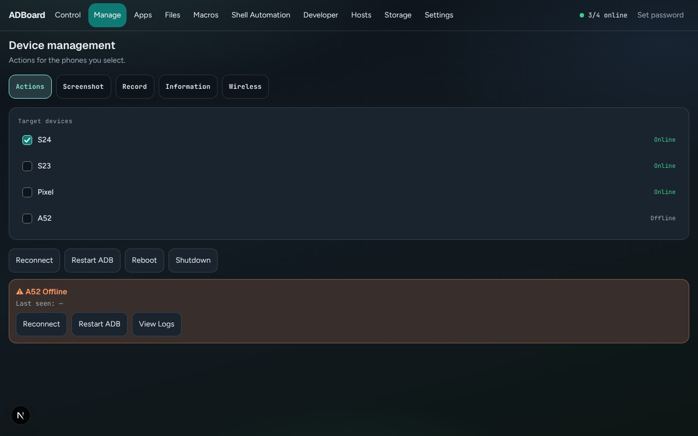
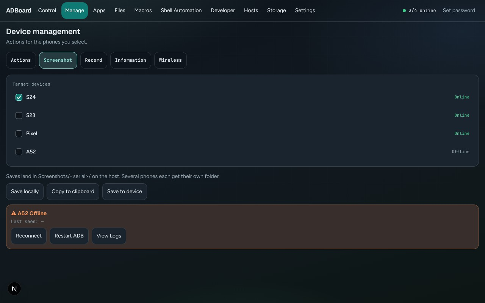
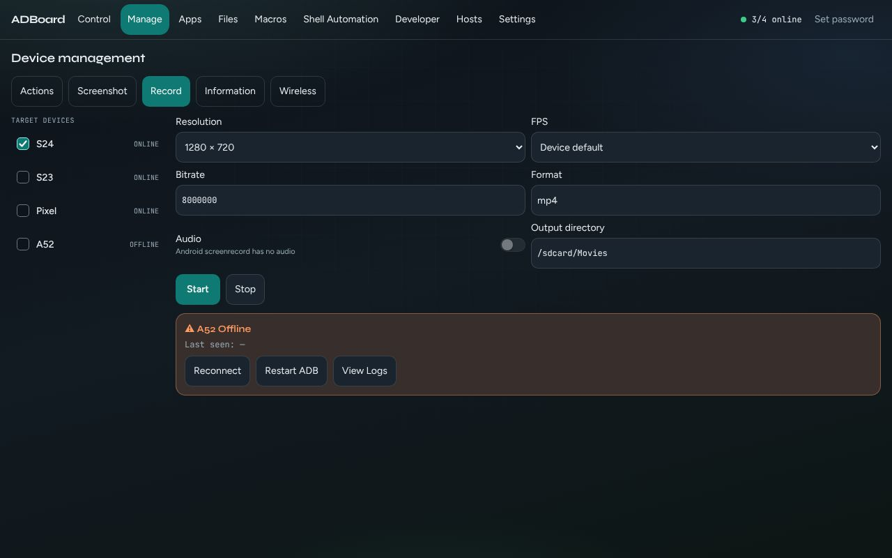
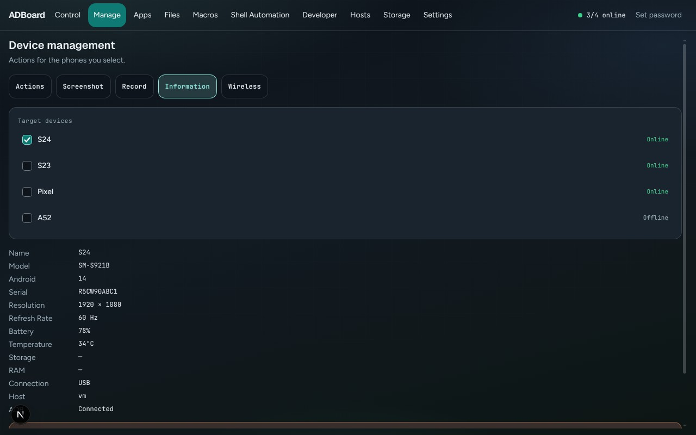
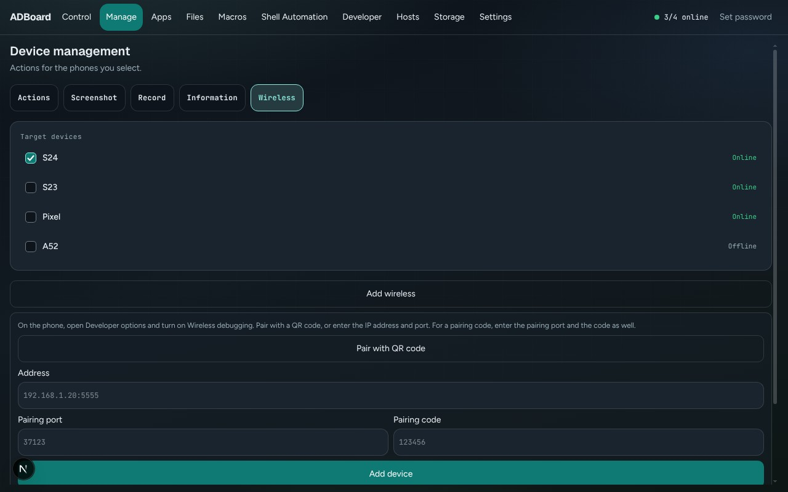

Back to the [guide index](README.md)

# Manage

The Manage tab is where you look after your phones as devices. You can reconnect them, restart their ADB link, reboot or shut them down, take screenshots, record the screen, read basic phone details and add phones over Wi-Fi. Almost everything works on the phones you tick in the **Target devices** list, so one click can act on several phones at once.

**ADB** (Android Debug Bridge) is the tool ADBoard uses to talk to your phones. "ADB link" below means that connection between the ADBoard computer and one phone.

## Contents

- [The common layout](#the-common-layout)
- [Actions](#actions)
- [Screenshot](#screenshot)
- [Record](#record)
- [Information](#information)
- [Wireless](#wireless)
- [Recovery list](#recovery-list)
- [How to](#how-to)
- [Good to know](#good-to-know)

## The common layout

The page title is **Device management**. Under it are five buttons: **Actions**, **Screenshot**, **Record**, **Information** and **Wireless**. The button for the open sub-tab is filled in.

Below that, the page has two columns:

- On the left, **Target devices**. Each phone has a tick box, its name and its state (for example Online or Offline). Tick the phones you want to act on.
- On the right, the controls for the open sub-tab, then a result list, then (if any phone is offline) the recovery list.

When you open Manage, the phones you already had selected on the Control tab are ticked. If none were, the phone you were last looking at is ticked.

## Actions

*Actions: four buttons act on the ticked phones.*

| Button | What it does |
|---|---|
| Reconnect | Restarts ADBoard's live session with each ticked phone (the screen stream and control link). Works on phones that are currently offline too. |
| Restart ADB | Tells ADB to reconnect to each ticked phone. Works on offline phones too. |
| Reboot | Restarts the phone. Asks you to confirm first. |
| Shutdown | Powers the phone off. Asks you to confirm first. A powered-off phone has to be switched on by hand. |

Reboot and Shutdown always show a confirmation box first:

- With one phone ticked, the box is titled "Reboot Device?" or "Shut down device?" and lists the phone's name. Press **Reboot** or **Shutdown** in the box to go ahead, or **Cancel** (or the Escape key) to back out.
- With several phones ticked, the box is titled "Reboot 3 devices?" (or "Shut down 3 devices?"), lists every name and warns that this affects every checked phone. The confirm button stays greyed out until you type the word `reboot` or `shutdown` in the box.

## Screenshot

*Screenshot: choose where the picture goes.*

Screenshots are saved as PNG pictures. A short note on the page says: "Saves land in Screenshots/<serial>/ on the host. Several phones each get their own folder." The "host" is the computer running ADBoard, and the serial is the phone's own ID number.

| Button | What it does |
|---|---|
| Save locally | Takes a screenshot of each ticked phone, stores it on the ADBoard computer and also downloads it through your browser, named after the phone. |
| Copy to clipboard | Takes a screenshot and copies the picture so you can paste it elsewhere. The result line says "Copied to clipboard". Your browser may refuse to give clipboard access; the result line then shows the reason. |
| Save to device | Takes the screenshot and keeps it on the phone itself, in its Pictures folder. The result line shows the file's name on the phone. |

Pictures saved on the ADBoard computer are in the Screenshots folder; you can browse them in the [Files tab](files.md). See [where ADBoard keeps your data](../storage.md).

## Record

*Record: the form, with Start and Stop.*

This records the phone screen to a video file (MP4) stored on the phone.

| Field | What it does |
|---|---|
| Resolution | 1280 x 720, 1920 x 1080, or Device size. |
| FPS | Device default, 30 or 60. This is only a request: the page tells you "Requested 30 fps. screenrecord uses the device frame rate." The phone picks its own frame rate. |
| Bitrate | Video quality as a whole number (bits per second). The starting value is 8000000. |
| Format | Always mp4. Read only. |
| Audio | Switched off and cannot be changed: Android's screen recorder has no audio. |
| Output directory | Where on the phone to put the file. The starting value is /sdcard/Movies. Must start with a slash. |

| Button | What it does |
|---|---|
| Start | Starts recording on each ticked phone. The result line shows the file path on the phone (the file is named adboard- followed by a number, ending .mp4). |
| Stop | Stops recording on each ticked phone. The file stays on the phone. |

A recording stops by itself after 3 minutes (180 seconds). To keep a recording, copy it off the phone with the [Files tab](files.md) (look in the Movies folder on the PHONE side).

## Information

*Information: details for one phone.*

This shows a list of facts about one phone. It uses the first ticked phone, or the phone you were last looking at if none is ticked. If there is no phone, it says "Select a device."

The list shows: Name, Model, Android (version), Serial, Resolution, Refresh Rate, Battery, Temperature, Storage, RAM, Connection (USB or Network), Host (the computer the phone is attached to) and ADB (Connected, or the phone's state). A dash means the value was not available. On demo phones, Storage and RAM are always blank.

## Wireless

*Wireless: add a phone over Wi-Fi.*

This lets you connect a phone without a cable. The phone and the ADBoard computer must be on the same network. Wireless connections need a real phone and working ADB; the demo phones cannot use this.

The sub-tab opens with an **Add wireless** button (it opens or closes the form) and a form that starts open.

First, on the phone: open Developer options and turn on Wireless debugging. (Developer options is hidden until you tap the phone's Build number seven times in Settings, About phone.)

| Control | What it does |
|---|---|
| Pair with QR code | Starts QR pairing. A QR code appears. |
| Cancel (under the QR code) | Stops the QR pairing and hides the code. |
| Address | The phone's IP address, optionally with a port, for example 192.168.1.20:5555. If you leave the port out, 5555 is used. Spaces and symbols such as ; & \| are refused. |
| Pairing port | The "pairing" port shown on the phone's pairing screen (a different number from the connect port). Only needed with a pairing code. |
| Pairing code | The 6-digit code shown on the phone. Needs the pairing port too. |
| Add device | Connects (and pairs first, if you filled in the pairing port and code). The button reads "Connecting..." while it works. |
| Remove (next to a saved address) | Disconnects that phone and forgets the address. |

Messages appear under the form: grey for normal news, orange for errors. Successfully added phones are remembered in a saved list at the bottom of the form, so ADBoard can reconnect to them later.

## Recovery list

Whenever a phone is not online, an orange card appears at the bottom of every Manage sub-tab. It reads "<phone name> Offline" and "Last seen:" with a time. It has three buttons:

| Button | What it does |
|---|---|
| Reconnect | Same as the Actions button, for this phone only. |
| Restart ADB | Same as the Actions button, for this phone only. |
| View Logs | Opens Developer, Logs for this phone. See the [Developer guide](developer.md). |

## How to

### Take a screenshot of several phones

1. Open Manage, then **Screenshot**.
2. Tick the phones in **Target devices**.
3. Press **Save locally**.
4. Read the result list: each phone shows a tick and "Saved" (or a path), or a cross and the reason.

### Add a phone over Wi-Fi with a QR code

1. On the phone, turn on Developer options, then Wireless debugging.
2. In ADBoard open Manage, then **Wireless**, and press **Pair with QR code**.
3. On the phone, in Wireless debugging, tap Pair device with QR code and scan the code on screen.
4. Watch the message under the code. When pairing finishes, the phone is saved and shows up in the saved list and the device list.

### Add a phone over Wi-Fi with a pairing code

1. On the phone, open Wireless debugging and tap Pair device with pairing code. The phone shows a code and a pairing address and port.
2. In ADBoard, type the phone's IP address in **Address**, the pairing port in **Pairing port** and the code in **Pairing code**.
3. Press **Add device**.

Once a phone has been paired, you can connect later by entering just the address and port from the main Wireless debugging screen.

### Reboot a phone safely

1. Open **Actions** and tick only the phone you mean.
2. Press **Reboot**.
3. Check the name in the box, then press **Reboot** in the box.

## Good to know

- Nothing happens until at least one phone is ticked. Buttons do nothing with an empty selection.
- Reboot and Shutdown always ask first. With more than one phone you must also type the word to confirm.
- The result list shows one line per phone: a tick and the outcome, a cross and the error, or a dash and "Skipped" for phones you did not tick. A ticked phone that is offline shows "No result", because ADBoard does not send commands to phones that are not online. The exceptions are Reconnect and Restart ADB, which do try offline phones.
- Screen recordings stay on the phone and last at most 3 minutes.
- On the demo phones, screenshots are tiny blank placeholder pictures, and Reboot, Shutdown, Record and Wireless report that ADB is not available. They need a real phone and ADB.
- Phones on another computer ("host") are handled by that computer. If it cannot be reached, the result line says so. See the [Hosts guide](hosts.md).
