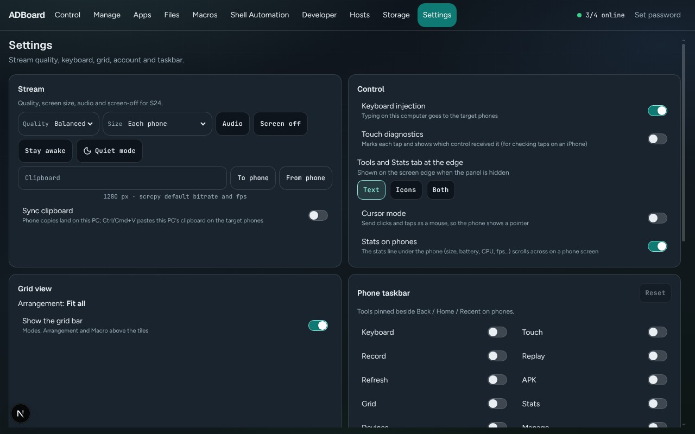

Back to the [guide index](README.md)

# Settings

The **Settings** tab is one place for the choices that change how ADBoard looks and behaves: how the phone screens are streamed, how your keyboard and mouse reach the phones, how the grid and the phone taskbar are arranged, your account, and where ADBoard keeps your data. Every switch here is the same switch you find elsewhere in ADBoard (for example in Control), so a change made here shows up there too.

> The screenshot in this guide uses demo phones, so the phone screens show no picture.

*Settings: one card per topic. Some cards only appear in certain situations.*

## Contents

- [Install on iPhone](#install-on-iphone)
- [Stream](#stream)
- [Control](#control)
- [Grid view](#grid-view)
- [Phone taskbar](#phone-taskbar)
- [Account](#account)
- [Data and storage](#data--storage)
- [What is shared by all browsers and what is remembered per browser](#what-is-shared-by-all-browsers-and-what-is-remembered-per-browser)

The cards appear in this order. On a wide screen they sit in two columns.

## Install on iPhone

This card only appears when you open ADBoard on an iPhone or iPad. iOS shows no install prompt of its own, so the card tells you how to put ADBoard on the Home Screen:

1. In Safari, tap the **Share** button (the square with an arrow) in the toolbar.
2. Scroll down and tap **Add to Home Screen**.
3. Keep **Open as Web App** on (iOS 26), then tap **Add**.
4. Open ADBoard from the new icon. It runs full screen, without the browser bars.

In another browser on iOS, the card tells you to use that browser's Share menu (iOS 16.4 or newer) or to open the page in Safari, then tap **Add to Home Screen** and **Add**.

Once ADBoard is running as a Home Screen app, the card just says so. After an ADBoard update, remove the icon and add it again from Safari so iOS picks up the new version.

## Stream

These settings control how each phone's live screen is sent to your browser. A line at the top says which phones they apply to: the selected phone, or "N target phones" when several are targeted. The controls are greyed out when there is no phone.

**Quality** sets the picture size, bitrate and frame rate together:

| Choice | What you get |
|---|---|
| **Low** | 720 px, 1 Mbps, 15 frames per second |
| **Balanced** | 1280 px, scrcpy's default bitrate and frame rate (the starting choice) |
| **High** | 1920 px, 8 Mbps, 60 frames per second |
| **Original** | The phone's own size, 16 Mbps, 60 frames per second |
| **Custom** | You choose the three values yourself (below) |

Lower quality uses less network and less PC power, which helps when you watch many phones at once. When a quality change needs it, the stream restarts and a note says "Stream restarted for the new setting."

With **Custom**, three boxes appear:

- **Max size px**: the longest side of the picture in pixels. 0 keeps the phone's own size. Allowed range 0 to 4096.
- **Bitrate Mbps**: from 0.25 to 40.
- **FPS**: frames per second, from 5 to 120.

Press **Apply** to use them. A value outside the range is moved to the nearest allowed value rather than refused. The starting values are 1280, 4 Mbps and 30 fps.

**Size** (labelled "Match screen size") changes the actual screen size of the phones. It applies to **every online phone**, not just the targets, and the streams restart on the new size. Choices:

- **Each phone**: puts every phone back to its own screen.
- **900x1600**.
- **16:9** (1080x1920).
- **20:9** (1080x2400).
- **900x1600 - 320 dpi**: size and density together, for macros that were made on a 900x1600 phone at 320 dpi.

It is greyed out when no phone is online. ADBoard remembers your choice. A note says "No online phones to resize." if none are online.

The row of switches:

- **Audio**: sends the phone's sound to your computer. If it cannot start, a note says why.
- **Screen off**: turns the phone's own screen off while the picture in ADBoard stays on ("Device screen off. The mirror stays on.").
- **Stay awake**: keeps the phone awake while it is connected (it does not turn the screen off). This is a setting on the phone itself, read from the phone, not saved in your browser.
- **Quiet mode**: for **every** online phone, not just the targets, turns the screens off and mutes the sound. Turning it off puts the screens back on and restores the volume. Phones that are offline are left out.
- **Clipboard** box with **To phone** and **From phone**: type or paste text in the box and press **To phone** to paste it on the target phones. **From phone** reads the first target phone's clipboard into the box and copies it to your computer's clipboard. If the box is empty, **To phone** tries to read your computer's clipboard (your browser may ask permission). On a narrow screen this box and its buttons are hidden.

Below the row is **Sync clipboard**: text a phone copies lands on your computer, and Ctrl/Cmd+V pastes your computer's clipboard on the target phones. Under the switches a short note may show the latest result.

## Control

Four switches:

| Switch | What it does |
|---|---|
| **Keyboard injection** | Typing on your computer goes to the target phones. On by default. |
| **Touch diagnostics** | Marks each tap and shows which control received it. Useful for checking taps on an iPhone. Off by default. |
| **Cursor mode** | Sends clicks and taps as a mouse, so the phone shows a pointer. Off by default. |
| **Stats on phones** | The stats line under the phone (size, battery, CPU, frame rate and so on) scrolls across on a phone screen. On shows the line (Show); off hides it (Hide). |

## Grid view

- **Arrangement** shows the current layout of the grid: **Fit all** (ADBoard picks the best number of columns and rows) or a fixed size such as "3 x 2". When a fixed layout is in use, the **Use Fit all** button returns to the automatic layout. You choose a fixed layout from the grid itself, not from here.
- **Show the grid bar**: shows or hides the bar of Modes, Arrangement and Macro above the tiles.

## Phone taskbar

The row of pinned tools that sits beside **Back / Home / Recent** on phones. Each tool has a switch: **Keyboard**, **Touch**, **Record**, **Replay**, **Refresh**, **APK**, **Grid**, **Stats mode**, **Devices**, **Desk**, **Cursor**, **Restart device**, **Device info**, **Device actions**, **Rotate**, **Fullscreen**, **Pop out**, **Quiet mode**, **Macros**, **Screenshot** and **Screen record**. Once a tool is pinned, **Order (left to right)** lists the pinned tools with **Up** and **Down** buttons to change their order. Back, Home, Recent and Minimize always stay. **Show on the bar** lets you hide Volume down, Volume up and Power. Tools that this browser can't run, such as Fullscreen in some browsers, are marked as not available.

You can pin up to 21 tools. When you reach the limit the remaining switches are greyed out until you turn one off. **Reset** removes all pins (it is greyed out when none are pinned). By default nothing is pinned and the taskbar only has Back, Home and Recent.

## Account

This card only appears when a password is in use, or when you can still set one. It says who you are signed in as ("Signed in as admin.") or, if there is no password yet, "No password yet: needed before using ADBoard through a reverse proxy."

- **Set password** (no account yet) or **Change password** opens a form. A first password needs a username and a new password you type twice. Changing it also asks for the current password. You can only set the first password when you open ADBoard directly on the PC's own network, not through a proxy.
- **Sign out** ends your session on this browser. It is shown when a password is set.

A password is required to reach ADBoard from outside your home network. See [Remote access](../../README.md#remote-access-nginx-proxy-manager--cloudflare) for the full steps with Nginx Proxy Manager and Cloudflare. Your password is never stored in a readable form, only as a salted hash.

## Data & storage

Data & storage now lives in the **Storage** tab. The Settings page has a short card that opens it. The Storage tab shows where ADBoard keeps your macros, scripts and settings, and gives you tools to back them up and move them. In the demo without the ADBoard agent it says "In-browser demo: macros and scripts are kept in this browser only. Export the library to keep a copy." and some buttons are missing.

**Folders.** First comes the **data folder** (on the Windows pack, the `ADBoard` folder in the repository root; other installs use `adboard-data` next to `ADBoard.exe`. The **Storage** tab shows the folder and lets you choose another one). A line says that updating, reinstalling or a Git pull never touches it, or, in portable mode, that the folder was set with `ADBOARD_DATA_DIR`. Then one row per folder, each with its full path:

| Folder | What is in it |
|---|---|
| **Data folder** | Everything below |
| **macros** | Touch macros, one `.adboard-macro.json` file each |
| **shell_scripts** | Shell Automation jobs, one `.adboard-shell.json` file each, and `_library.json` (apps, variables, groups, profiles) |
| **config** | Settings, layout per browser, editor state, queue, schedules, phone choices and the sign-in account |
| **logs** | `adboard.log` and the Shell Automation run history |
| **backups** | Earlier versions, deleted items, unreadable files, **Back up now** copies and data moved from older versions |
| **files** | The Files area: screenshots, recordings, APKs and downloads |

Each row has two buttons:

- **Open** opens that folder **on the ADBoard computer** (the PC the phones are plugged into), not on the device you are browsing from.
- **Copy path** copies the path to your clipboard. If copying is not allowed, the message shows the path so you can copy it yourself.

**Buttons.**

- **Back up now** copies the whole data folder to `backups\backup-<date>` and tells you the folder it made. It is only shown when ADBoard runs with its agent.
- **Export library** saves everything in one file, `adboard-library.json`: touch macros, Shell Automation jobs, apps, variables, groups, profiles, the macro queue, schedules and per-phone macro choices. To export just one macro or job, use Macros or the Shell Automation Library.
- **Import library** asks you to pick an `adboard-library.json`. The file is fully checked first, and if anything is wrong you get a message and nothing changes. Then you choose:
  - **Add (keep current items)**: keeps everything you have, adds what is new, skips items that are already here, and renames clashes by adding " 2".
  - **Replace...**: swaps your whole library for the file's contents. It asks to confirm ("Replace the whole library?") before it does anything, and says that every touch macro, Shell Automation job, queue item and schedule will be replaced.
  - **Cancel**.

  Either way, ADBoard makes an automatic backup of the current data first (in `backups`) when it runs with its agent, and the result message names that backup. The message also counts what was added, renamed and skipped for touch macros and for Shell scripts.

**Data from an older version.** If ADBoard moved data in from an older install, a line reads "Data from an older version: N moved here", with extras such as "N kept aside (data was already here)" or "N failed", and the folder holding the originals. Click it to open a list of each item and what happened to it. ADBoard never overwrites existing data: if you already had macros, the older copy stays in the backup and you can bring it in with **Import library**. If a move fails, the original stays where it was and the error is shown.

**Which files can I edit by hand?** Click this line to see the exact list. In short:

- Safe to edit or copy in while ADBoard is **closed**: the macro files in `macros`, the job files in `shell_scripts`, and `user_config.json` in `config`. ADBoard notices the change the next time it starts. A file it cannot read is copied to `backups\corrupt` and reported, the rest still loads, and nothing is deleted.
- Do not edit: files that ADBoard manages itself (the revision numbers, the per-browser layout and editor state, the migration record and the sign-in account).

For the whole folder layout, file naming, what is never saved (passwords and tokens) and the older-version move, see [where ADBoard keeps your data](../storage.md).

## What is shared by all browsers and what is remembered per browser

ADBoard saves your choices in the data folder on the ADBoard computer, so they follow you from one browser to another.

**Shared by every browser** (the newest change wins, whichever browser made it):

- Keyboard injection, Cursor mode and Touch diagnostics
- Stream: quality (and the custom values), audio, screen off, the Size choice, Sync clipboard and Quiet mode
- Stats on phones
- Grid arrangement and whether the grid bar is shown
- Phone taskbar pins
- The control mode and the Shell Automation run history

**Remembered separately for each browser** (a browser is told apart by an anonymous id, with a label such as "Chrome on Windows"):

- Layout and navigation: the open section, the last phone, folded panels, the grid view, the macro dock and your Files path
- Editor state for Shell Automation and Macros: the open job, the preview phone, the selected step, and which sub-tab you were on

A browser that opens ADBoard for the first time starts from the most recently used layout, so it does not start empty. **Stay awake** is not saved in any browser: it is a setting on the phones.

Nothing secret is saved in these files: no passwords, tokens or cookies.
