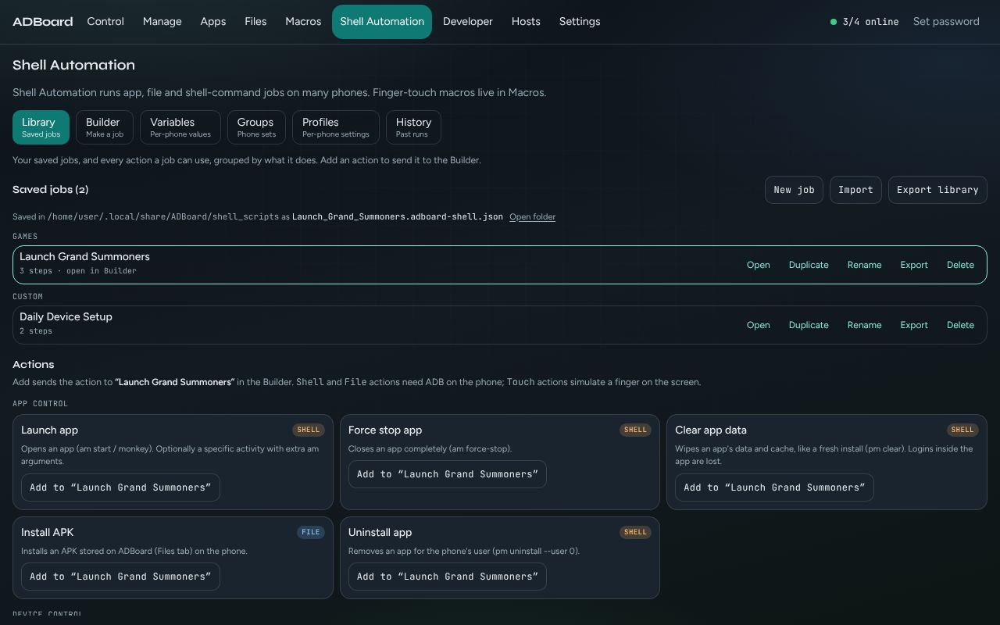
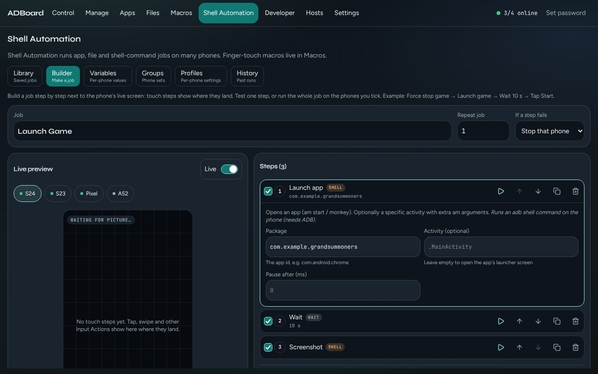
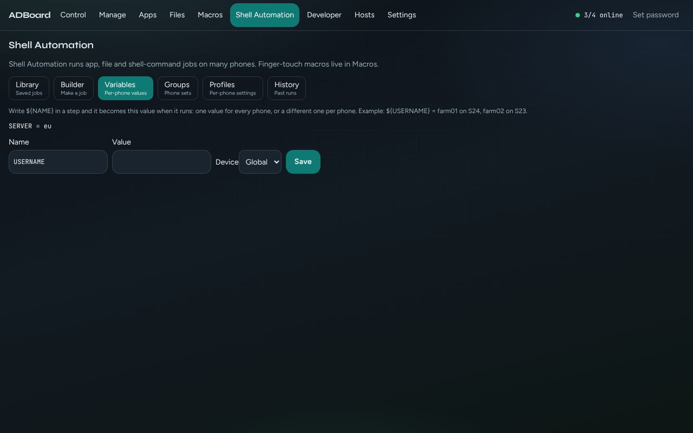
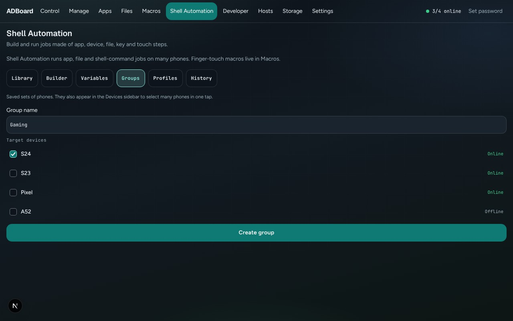
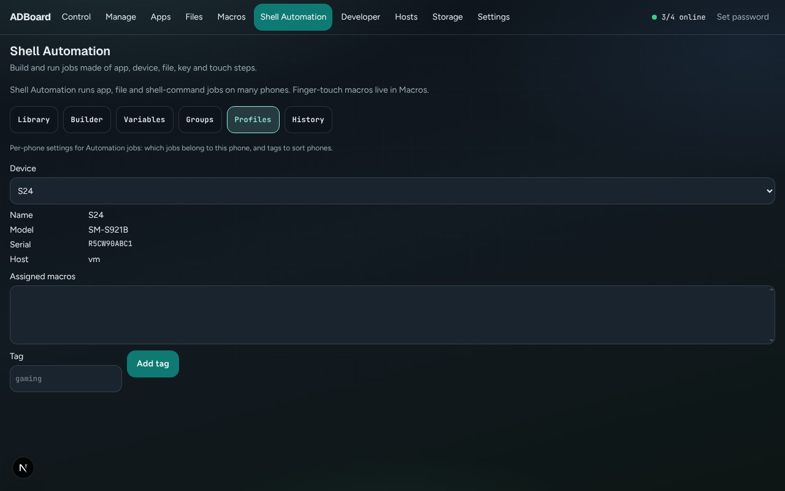
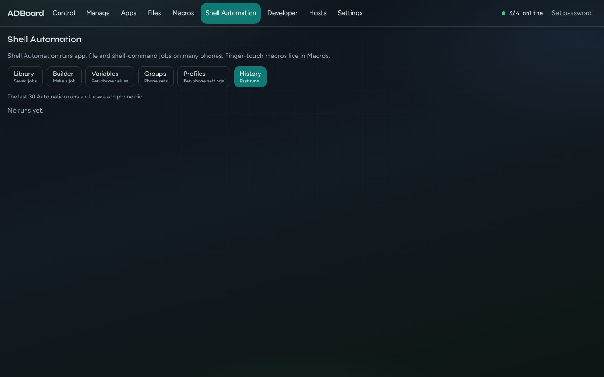

Back to the [guide index](README.md)

# Shell Automation

**Shell Automation** is where you build a **job**: a list of steps such as "open this app", "wait 10 seconds", "take a screenshot" or "send this file". You then run the job on one phone or on many phones at once.

A job is not the same as a touch macro. A [touch macro](../macros.md) replays finger movements with exact timing, and it can keep running in the background. A job says what the phone should do (open an app, install something, press a key, copy a file). It runs from your browser, so keep the page open until it finishes. Use macros for "where does the finger go and when". Use jobs for "what should the phone do".

> The screenshots in this guide use demo phones, so the phone screens show no picture.

## Contents

- [The six sub-tabs](#the-six-sub-tabs)
- [Library](#library)
  - [Saved jobs](#saved-jobs)
  - [Actions](#actions)
  - [Every action and its fields](#every-action-and-its-fields)
- [Builder](#builder)
  - [Job settings](#job-settings)
  - [Live preview](#live-preview)
  - [Steps](#steps)
  - [Testing one step](#testing-one-step)
  - [Running a job](#running-a-job)
  - [Progress and the log](#progress-and-the-log)
  - [What needs ADB](#what-needs-adb)
- [Rules your steps are checked against](#rules-your-steps-are-checked-against)
- [Variables](#variables)
- [Groups](#groups)
- [Profiles](#profiles)
- [History](#history)
- [Worked example 1: open a game, wait, take a screenshot on every phone](#worked-example-1-open-a-game-wait-take-a-screenshot-on-every-phone)
- [Worked example 2: install an APK, then launch the app](#worked-example-2-install-an-apk-then-launch-the-app)
- [Where jobs are saved](#where-jobs-are-saved)

## The six sub-tabs

Open **Shell Automation** from the desk header. Along the top are six sub-tabs, in the order you normally use them:

| Sub-tab | What it is for |
|---|---|
| **Library** | Your saved jobs, and every action a job can use |
| **Builder** | Make a job step by step next to the phone's live screen, test it and run it |
| **Variables** | Values you can use inside steps, the same for every phone or different per phone |
| **Groups** | Saved sets of phones |
| **Profiles** | Per-phone notes and tags |
| **History** | The last 30 runs and how each phone did |

ADBoard remembers which sub-tab and which job you had open, so a reload brings you back to the same place.

## Library

*Library: saved jobs on top, the action catalogue below.*

### Saved jobs

The top of the Library lists every saved job, grouped by **folder**. Only folders that contain jobs are shown. The heading shows how many jobs you have, for example "Saved jobs (3)". Each job shows its name, its number of steps and, if you set it, how many times it repeats (for example "x3").

Above the list:

- **New job** opens the Builder so you can name a new job and pick its folder.
- **Import** reads a file and adds it to your library. See [Import](#import).
- **Export library** saves everything (touch macros, jobs, the macro queue and schedules) as one file, `adboard-library.json`.

Under the heading a line says **Saved in** followed by the folder on the ADBoard computer, and the file name of the job you have open. **Open folder** opens that folder on the ADBoard computer. This line only appears when ADBoard is running with its agent.

Each job has five buttons:

| Button | What it does |
|---|---|
| **Open** | Opens the job in the Builder. Clicking the job name does the same. |
| **Duplicate** | Makes a copy called "<Name> copy" (or "<Name> copy 2" and so on if that exists). |
| **Rename** | Asks for a new name. Two jobs cannot share a name: if yours is taken, a number is added and ADBoard tells you the name it used. |
| **Export** | Saves just this job as `<Name>.adboard-shell.json`. |
| **Delete** | Asks first ("Delete ...?"). The job's steps are removed. Export it first if you want a copy. |

If you have no jobs yet, the list says "No saved jobs yet. Add an action below, or press New job."

#### Import

**Import** works out what a file is from what is inside it, not from its name. It accepts:

- A single job file (`<Name>.adboard-shell.json`).
- The whole-library file `adboard-library.json`. Only its jobs, apps, variables, groups, tags and profiles are added here. Touch macros in that file are not imported on this screen (use Settings, see [Data and storage](settings.md#data--storage)).
- A desk export from an older version (it has jobs or apps in it), or a plain job file with a name and steps.

Import only ever **adds**. It never replaces what you have.

- A job that is already in the library, with the same contents, is **skipped**.
- A job whose name is already taken is added with " 2" (then " 3" and so on) after the name.
- Variables, per-phone values, tags and profiles that already exist are kept; only new ones are added.

When it finishes, a message says what happened, for example "Imported 2 scripts (1 renamed to avoid a duplicate name); 1 already here." If the file is not a Shell Automation file (for example it is a touch macro file), you get an error and nothing changes. A file made by a newer ADBoard than yours is refused with a message saying so.

### Actions

The lower half of the Library is the **Actions** catalogue: everything a step can do, grouped by category. Each card shows the action's name, a small label for how it reaches the phone, a one-line description and an **Add** button.

- If a job is open, the button reads **Add to "<job name>"** and puts the action at the end of that job, then switches to the Builder.
- If no job is open, it reads **Add to a new job** and creates a job called "New job" in the "Custom" folder.

The small label on each card tells you how the action reaches the phone:

| Label | Meaning |
|---|---|
| **Shell** | Runs a command on the phone through ADB. Needs ADB. |
| **Touch** | A simulated finger on the screen, at a position you set on the live preview. |
| **Key** | Presses an Android key (Home, Back and so on). |
| **File** | Moves a file between ADBoard and the phone. Needs ADB. |
| **Wait** | Waits on ADBoard. Nothing is sent to the phone. |

### Every action and its fields

Fields marked "optional" can be left empty. Everything else must be filled in before the job can run. A step also always has **Pause after (ms)**, which waits that long after the step finishes (see [Steps](#steps)).

**App Control**

| Action | Type | What it does | Fields |
|---|---|---|---|
| **Launch app** | Shell | Opens an app. | **Package** (for example `com.android.chrome`); **Activity** (optional; leave empty to open the app's normal start screen) |
| **Force stop app** | Shell | Closes an app completely. | **Package** |
| **Clear app data** | Shell | Wipes an app's data and cache, like a fresh install. Logins inside the app are lost. | **Package** |
| **Install APK** | File | Installs an APK that is stored on ADBoard (in the Files tab) onto the phone. | **APK on ADBoard** (path in the Files tab, for example `Downloads/game.apk`) |
| **Uninstall app** | Shell | Removes an app for the phone's user. | **Package** |

**Device Control**

| Action | Type | What it does | Fields |
|---|---|---|---|
| **Shell command** | Shell | Runs one command on the phone. The output appears in the log. | **Command** (one line; `${NAME}` variables are filled in first) |
| **Screenshot** | Shell | Takes a screenshot and saves it on ADBoard (Files, Screenshots). | none |
| **Start screen recording** | Shell | Starts recording the phone's screen (3 minutes at most). | **Bitrate (bits/s)** (default 8000000); **Size** (optional, for example `1280x720`); **Folder on phone** (optional, default `/sdcard/Movies`) |
| **Stop screen recording** | Shell | Stops a recording started by Start screen recording. | none |
| **Reboot** | Shell | Restarts the phone. It goes offline until it boots again, so add **Wait for phone** after it. Asks before running. | none |
| **Power off** | Shell | Turns the phone off. It cannot be turned on again remotely. Asks before running. | none |

**Input Actions**

Positions are percentages of the phone's screen (0 is the left edge or the top, 100 is the right edge or the bottom), so a step lands in the same place on phones of any size.

| Action | Type | What it does | Fields |
|---|---|---|---|
| **Tap** | Touch | Taps one point. | **X %**, **Y %** |
| **Double tap** | Touch | Two quick taps on the same point. | **X %**, **Y %** |
| **Long press** | Touch | Holds a finger on one point. | **X %**, **Y %**, **Hold time** (ms) |
| **Swipe** | Touch | Slides a finger from a start point to an end point. | **X %**, **Y %**, **End X %**, **End Y %**, **Swipe time** (ms) |
| **Drag** | Touch | Presses and holds, then moves to the end point (moves icons, sliders). | **X %**, **Y %**, **End X %**, **End Y %**, **Total time** (ms) |
| **Scroll** | Touch | A straight swipe up or down from a point, to scroll a list. | **X %**, **Y %**, **Finger moves** (Up shows content below; Down shows content above), **Distance %**, **Swipe time** (ms) |
| **Pinch / zoom** | Touch | Two fingers move apart (zoom in) or together (zoom out) around a point. | **X %**, **Y %**, **Fingers** (Move apart, or Move together), **Distance %**, **Pinch time** (ms) |
| **Type text** | Shell | Types text into the field that has focus. | **Text** (for example `${USERNAME}`). Letters, numbers, spaces and simple punctuation only, see [the rules](#rules-your-steps-are-checked-against). |
| **Recorded touch** | Touch | A touch path you recorded with **Record touches** in Control. It replays exactly as recorded. | none. It cannot be added from the Library or the Builder; it appears as a job in the "Recorded" folder. |

**Navigation**

| Action | Type | What it does | Fields |
|---|---|---|---|
| **Press key** | Key | Presses an Android key. | **Key**: Home, Back, Recent apps, Power, Volume up or Volume down |

**Files**

| Action | Type | What it does | Fields |
|---|---|---|---|
| **Send file to phone** | File | Copies a file from ADBoard's Files tab to a folder on the phone. | **File on ADBoard** (for example `Downloads/config.json`); **Folder on phone** (default `/sdcard/Download/`) |
| **Get file from phone** | File | Copies a file from the phone into a folder in ADBoard's Files tab. | **File on phone** (for example `/sdcard/Download/log.txt`); **Folder on ADBoard** (default `Downloads`) |
| **Delete file on phone** | Shell | Deletes a file or folder on the phone. Storage roots are refused. | **Path on phone** |

**Delays**

| Action | Type | What it does | Fields |
|---|---|---|---|
| **Wait** | Wait | Pauses before the next step. | **Wait** (ms, default 1000) |

**Flow Control**

| Action | Type | What it does | Fields |
|---|---|---|---|
| **Wait for app** | Shell | Waits until the app is running. Fails the step if it takes too long. | **Package**, **Time limit** (ms, default 15000) |
| **Wait for phone** | Wait | Waits until the phone is online again, for example after Reboot. Fails after the time limit. | **Time limit** (ms, default 120000) |
| **Wait for live screen** | Wait | Waits until the phone's live screen is running. Needed for touch steps after a reconnect. | **Time limit** (ms, default 20000) |
| **Set wait time limit** | Wait | Sets the default time limit for the "Wait for ..." steps after it that have no limit of their own. | **Time limit** (ms, default 15000) |

All times are in milliseconds (1000 ms is one second).

## Builder

*Builder: job settings on top, live preview on the left, steps and the Run card on the right.*

If no job is open, the Builder shows a small form: **Job name**, **Folder** (Testing, Games, Custom, or any folder already in use) and **Create job**. You can also open a saved job from the Library.

### Job settings

Across the top of an open job:

- **Job**: the job's name. Two jobs cannot have the same name, and a blank name becomes "Untitled script". If you type a name that is taken, a number is added when you leave the field.
- **Repeat job**: how many times the whole job is played on each phone. 1 to 10000. The default is 1.
- **If a step fails**: choose **Stop that phone** (the default; that phone's run ends at the failed step and the other phones carry on) or **Note it and go on** (the failure is written in the log and the job continues with the next step).

### Live preview

On the left is the chosen phone's live screen, with the job's touch steps drawn on it as numbered markers (arrows for swipes, drags, scrolls and pinches). The numbers match the step order.

- Pick which phone to look at with the chips above the picture. A phone that is offline shows a warning and no picture.
- **Live** switches the live video on or off. Turn it off to edit without streaming.
- To place a touch step, either drag its marker on the picture, or select the step and press **Set step N position** (for a pinch it says **centre**), then click the screen. Swipe and drag steps also have **Set end**.
- The position fields in the step update as you move a marker, and typing a number in the field moves the marker.

### Steps

The **Steps (N)** card lists the steps in order. Each row shows the step number, its name, its type label, and a short summary of its settings. Row controls, left to right:

- A **checkbox** turns the step on or off. A step that is off is skipped (the log says "turned off").
- Clicking the row opens its fields for editing. Click again to close it.
- A **play button** tests this one step (see below).
- **Up** and **down** arrows move the step.
- **Duplicate** makes a copy just after it.
- **Delete** removes it.

Every step also has **Pause after (ms)**, a wait that happens after the step has finished. The row then reads "then 500 ms" in its summary.

To add a step, use the **Add** list at the bottom of the card. It is grouped by category and shows each action with its type. The button next to it reads **Add step**, or **Add after N** when a step is selected, and inserts the new step right after the selected one. For a touch step it also starts position-setting mode, so your next click on the live preview sets its position.

A step with a problem has a red outline and says "needs fixing". Its field shows the reason under it.

### Testing one step

The play button on a step runs just that step, once, on the phone shown in the preview. "Pause after" is not used in a test. The button is disabled while a run is in progress, when there is no phone to test on, and when the step is switched off. If the step has errors, or the phone is offline, a short message appears instead of running. A step that restarts or powers off the phone asks you to confirm first. The result shows in the step's row and in the **Log**. A test is not saved to History.

### Running a job

The **Run** card is where you start a job.

1. Under **Target devices**, tick the phones. Each shows whether it is online or offline.
2. If you have tagged phones in [Profiles](#profiles), an **Add by tag** row appears. Click a tag such as `#gaming` to tick every phone with that tag (it adds to what is already ticked).
3. Under **Several phones**, choose how the phones are handled:
   - **At the same time**: all ticked phones run the job together.
   - **One after another**: each phone finishes before the next starts.
4. Press **Run on N phones** (with "x3" added when the job repeats). While the job runs the button turns into **Stop**. Stop ends the run after the step in progress; waits end at once.

Things that can stop a run from starting:

- "Fix N step(s) marked in red first." Steps that are switched off are not counted.
- "Tick at least one phone."
- A phone that is offline when the run starts is skipped ("Skipped (offline)").

**Reboot** and **Power off** always ask first. The question is "Restart or power off phones?" and it names the steps and the phones. Press **Run** to go on or **Cancel** to stop.

The page says "Runs from this page: keep it open until the job ends." If you close the page, the run stops. Your ticked phones, the At the same time or One after another choice, and the step you had selected are remembered for next time.

### Progress and the log

Each phone has a progress bar and a status:

- **Ready** or **Offline** before a run
- **Step 3/8** while running
- **Completed** when all steps are done
- **Step N failed: reason**
- **Skipped (offline)**
- **Stopped at step N**

If a phone disconnects during a run, it fails at its next step with "Phone disconnected". The other phones go on.

The **Log** below lists the result of every step on every phone, with the time, the phone, the step number (and "run 2" and so on when the job repeats), the action, and any output or error message. Tick **Failures only** to show just the failures. **Clear** empties the log. The log keeps the most recent 500 entries and starts empty again after a reload.

The finished run is also saved to [History](#history). A single-step test is not.

### What needs ADB

**Shell** and **File** actions need ADB on the phone (a real phone connected through USB or Wi-Fi ADB). On the demo phones used for screenshots, those steps fail with a message such as "adb is not available". Touch and Press key steps on a demo phone report "mock phone: touch not sent" or "mock phone: key not sent" instead of claiming success. **Wait** steps never touch the phone.

## Rules your steps are checked against

ADBoard checks each step as you type, with the same rules the agent applies when it runs. If a step breaks a rule, it is outlined in red and the job will not run until you fix it.

- **Required fields**: any field not marked "(optional)" must be filled in. The message is "Required".
- **X %, Y %, End X %, End Y %, Distance %**: a number from 0 to 100.
- **Times** (Hold time, Swipe time, Wait, Time limit and so on): 0 to 3,600,000 ms (one hour).
- **Package**: only letters, numbers, underscores and dots, and it must contain at least one dot, like `com.example.app`. If the package uses a `${NAME}` variable, it is checked with the variable in place.
- **Type text**: these characters cannot be typed: `;` `|` `&` `` ` `` `$` `(` `)` `<` `>` `'` `"` `\` and line breaks. This is a limit of how Android types text. A `${NAME}` placeholder itself is allowed. Letters, numbers, spaces and simple punctuation such as `.`, `,`, `-`, `@` and `!` are fine.
- **Shell command**: one line, up to 2000 characters.
- **File on phone**, **Path on phone**, **Folder on phone** (for Send file and Start screen recording): must be an absolute path starting with `/`.
- **Start screen recording**: **Bitrate (bits/s)** digits only; **Size** like `1280x720` (two numbers with an x between them).
- **Recorded touch**: must not be empty.

## Variables

*Variables: global values, per-phone values and the form to add them.*

A variable lets one job behave differently on each phone. Write `${NAME}` inside a step and ADBoard replaces it with the variable's value when the job runs. Names use capital letters, digits and underscores, for example `${USERNAME}` or `${LEVEL_2}`.

Example: set `USERNAME` to `farm01` on one phone and `farm02` on another, then use a **Type text** step with the text `${USERNAME}`. Each phone types its own name.

To add a value, fill in the form:

1. **Name**: the variable name, without `${ }` (the form starts with `USERNAME`).
2. **Value**: what it should become.
3. **Device**: **Global** for one value used on every phone, or pick a phone to give only that phone its own value.
4. Press **Save**. Saving a name that already exists replaces its value.

Global values are listed at the top as `NAME = value`. Per-phone values are listed underneath, under each phone's name. If a phone has its own value for a name, that wins over the global one.

Variables are filled in for these fields: **Package**, **Text**, **Command**, **APK on ADBoard**, **File on ADBoard**, **File on phone** and **Path on phone**. They are not filled in for **Activity** or for the "Folder on phone" and "Folder on ADBoard" fields. A variable that has no value on a phone becomes empty.

## Groups

*Groups: saved sets of phones and the form to create one.*

A group is a saved set of phones, for example "Gaming". Groups also appear in the **Devices** sidebar, so you can select many phones in one tap.

To make one, type a **Group name**, tick the phones in **Target devices**, and press **Create group**. Each existing group shows its name and its phones, with a **Delete** button. Deleting a group does not touch the phones.

## Profiles

*Profiles: one phone's details, its job list and its tags.*

A profile holds a few things for one phone. Pick the phone with **Device**. You then see:

- **Name**, **Model**, **Serial** and **Host** of the phone (read only).
- **Assigned macros**: a list of your jobs. Select the ones that belong to this phone (hold Ctrl or Cmd to select several). This is a note kept with the phone. Running a job still uses the phones you tick in the Builder.
- **Tag**: type a word such as `gaming` and press **Add tag** to label the phone. Tags appear as small `#gaming` chips. Click a chip to remove that tag. Tags are what the Builder's **Add by tag** row uses to tick phones quickly.

If there are no phones, the tab says "No devices."

Profiles can also hold position overrides for a phone, so a touch step lands somewhere different on that phone. They are used when a job runs, but there is no screen yet to edit them.

## History

*History: the most recent runs, newest first.*

History lists the last 30 runs of a whole job, newest first. Each run shows the job name, whether it ran **Parallel** (at the same time) or **Sequential** (one after another), the time it started, and one line per phone with its result (for example "Phone A done", or "Phone B failed" with the reason). When there are no runs yet it says "No runs yet." Older runs are dropped when there are more than 30. Testing a single step is never listed here.

## Worked example 1: open a game, wait, take a screenshot on every phone

Goal: on every phone, start a game, give it time to load, then save a screenshot.

1. Open **Shell Automation** and go to the **Library** sub-tab.
2. Press **New job**. In the Builder, type a **Job name** such as "Game check", leave **Folder** on Custom (or pick Games) and press **Create job**.
3. In the **Add** list at the bottom of the **Steps** card, choose **Launch app** under App Control and press **Add step**. Open the new step and type the **Package** of your game, for example `com.example.game`. Leave **Activity** empty.
4. Choose **Wait** under Delays, press **Add after 1**, and set **Wait** to `15000` (15 seconds) so the game has time to load.
5. Choose **Screenshot** under Device Control and press **Add after 2**. It has no fields.
6. Under **If a step fails**, choose **Note it and go on** if you want the other steps to run even when one fails.
7. Optional: click the play button on step 1 to test it on the phone in the preview first. Check the result in the **Log**.
8. In the **Run** card, tick every phone in **Target devices**. Under **Several phones**, choose **At the same time**.
9. Press **Run on N phones**. Watch each phone's progress bar. If a step fails, tick **Failures only** in the **Log**.
10. Open the **Files** tab and look in Screenshots for the pictures. The run is also listed in **History**.

## Worked example 2: install an APK, then launch the app

Goal: put an APK on each phone and open the app.

1. In the **Files** tab, upload your APK, for example into `Downloads` so its path is `Downloads/game.apk`.
2. In **Shell Automation**, press **New job** in the Library, name it "Install game" and press **Create job**.
3. Add **Install APK** (App Control). In **APK on ADBoard** type `Downloads/game.apk`.
4. Add **Launch app** (App Control). In **Package** type the app's package name, for example `com.example.game`.
5. Add **Wait for app** (Flow Control) and put the same package in **Package**. Leave **Time limit** at `15000`, or raise it for a slow app. This step fails if the app does not start in time, so you will know.
6. Add **Screenshot** (Device Control) if you want proof that it opened.
7. Check that no step is outlined in red. Install APK and Launch app need ADB, so use real phones.
8. In the **Run** card, tick the phones. Choose **One after another** if you want the installs to go one at a time and put less strain on the PC.
9. Press **Run on N phones** and watch the progress. When it finishes, each phone says **Completed**.
10. If an install fails, the **Log** shows the message from the phone. Use **Failures only** to find it.

## Where jobs are saved

Each job is its own file named `<Name>.adboard-shell.json` in the `shell_scripts` folder of the ADBoard data folder (on Windows, `%LOCALAPPDATA%\ADBoard`). Your variables, per-phone values, tags, groups, apps and profiles are kept together in one file, `_library.json`, in the same folder. Everything is saved as soon as you edit.

Exports: one job is `<Name>.adboard-shell.json`; the whole library is `adboard-library.json`. See [where ADBoard keeps your data](../storage.md) for the full folder layout, backups and which files are safe to edit by hand, and [Settings](settings.md) for importing and exporting the whole library.
